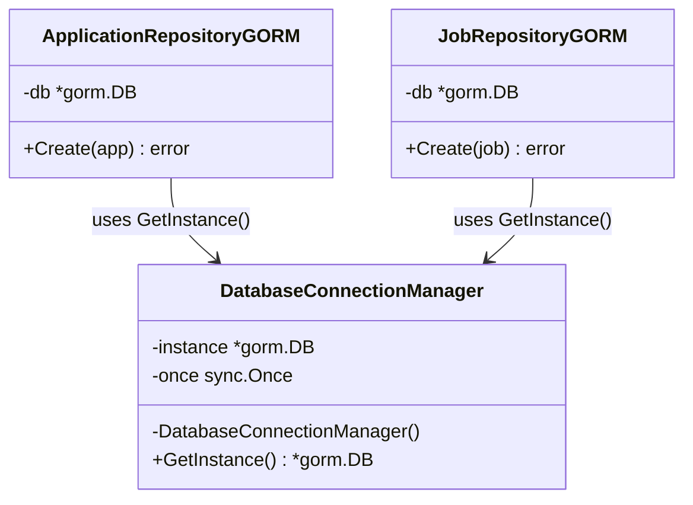
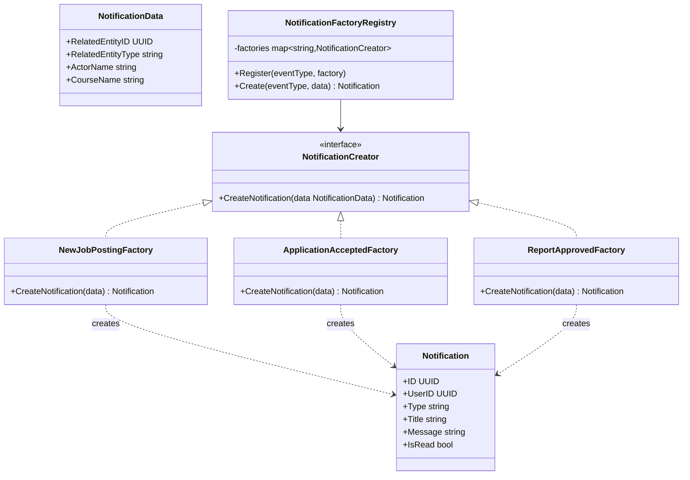
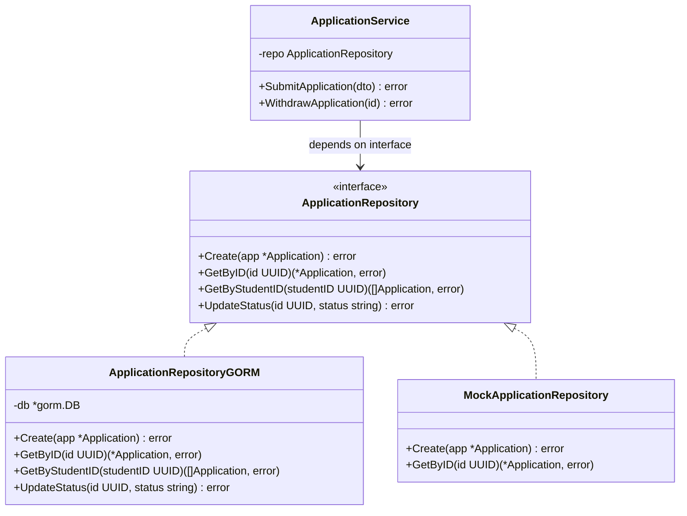
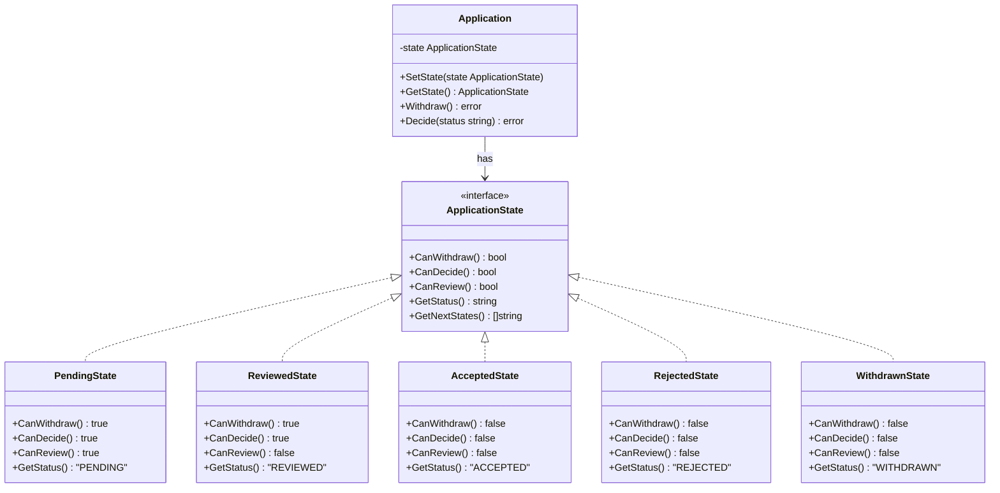

# Design Pattern with Code Implementation

## MyAsdos — Sistem Informasi Gabungan Akademik Portal

## Daftar Isi

1. [Pendahuluan](#1-pendahuluan)
2. [Struktur Folder & Layered Architecture](#2-struktur-folder--layered-architecture)
3. [Class Diagram Sistem (Ringkas)](#3-class-diagram-sistem-ringkas)
4. [Pattern 1: Singleton (Creational)](#4-pattern-1-singleton-creational)
5. [Pattern 2: Factory Method (Creational)](#5-pattern-2-factory-method-creational)
6. [Pattern 3: Repository (Structural)](#6-pattern-3-repository-structural)
7. [Pattern 4: State (Behavioral)](#7-pattern-4-state-behavioral)
8. [Kode Lengkap Main Entry Point](#8-kode-lengkap-main-entry-point)
9. [Penutup](#9-penutup)

---

## 1. Pendahuluan

### 1.1 Tujuan Dokumen

Dokumen ini mendefinisikan **4 (empat) Design Pattern** yang diimplementasikan pada backend sistem **MyAsdos** menggunakan bahasa pemrograman **Go (Golang)**. Keempat pattern ini dipilih berdasarkan analisis kebutuhan fungsional dari PRD (Product Requirements Document) dan arsitektur layered yang telah didefinisikan pada dokumen Software Architecture Design (SAD).

### 1.2 Daftar Pattern yang Diimplementasikan

| No  | Kategori   | Pattern            | Lokasi Implementasi                        | Fitur PRD                       |
| --- | ---------- | ------------------ | ------------------------------------------ | ------------------------------- |
| 1   | Creational | **Singleton**      | `infrastructure/database/connection.go`    | Database connection pool        |
| 2   | Creational | **Factory Method** | `domain/factory/notification.go`           | M8 — Notifikasi event-driven    |
| 3   | Structural | **Repository**     | `infrastructure/repository/application.go` | M1-M9 — Data access abstraction |
| 4   | Behavioral | **State**          | `domain/state/application.go`              | M3 — State machine lamaran      |

---

## 2. Struktur Folder & Layered Architecture

### 2.1 Mengapa Struktur Folder Dibuat Seperti Ini?

Struktur folder backend dirancang **ketat mengikuti Layered Architecture** yang telah didefinisikan di dokumen SAD (Section 3.1). Alasan utama pemisahan menjadi 3 layer adalah:

1. **Separation of Concerns**: Setiap layer hanya menangani tanggung jawabnya sendiri — Application Layer menangani HTTP, Domain Layer menangani business logic, Infrastructure Layer menangani teknis eksternal (DB, file, cache).
2. **Testability**: Dengan memisahkan business logic dari framework HTTP (Gin) dan library ORM (GORM), unit testing menjadi lebih mudah. Service layer dapat di-test tanpa harus menjalankan server HTTP.
3. **Maintainability**: Perubahan di satu layer tidak "merembet" ke layer lain. Misalnya, mengganti framework HTTP dari Gin ke Echo hanya mempengaruhi `app/handlers/`, tidak perlu ubah `domain/service/`.
4. **Scalability**: Stateless backend memungkinkan horizontal scaling. Layered architecture memastikan tidak ada state yang tersembunyi di business logic.
5. **Konsistensi dengan Go Idiom**: Go tidak punyi class inheritance, tapi punya `interface` yang powerful. Layered architecture di Go menggunakan interface untuk definisi kontrak antar layer (e.g., `ApplicationRepository` interface di domain, implementation-nya di infrastructure).

### 2.2 Struktur Folder Lengkap

```
myasdos-backend/
├── cmd/
│   └── main.go                              # Entry point aplikasi
│
├── internal/                                # Private package (Go convention)
│   ├── app/                                 # APPLICATION LAYER
│   │   ├── handlers/                          # Gin HTTP Controllers
│   │   │   ├── auth_handler.go
│   │   │   ├── job_handler.go
│   │   │   ├── application_handler.go
│   │   │   └── notification_handler.go
│   │   ├── middleware/                        # JWT, CORS, Rate Limit, RBAC
│   │   │   ├── auth_middleware.go
│   │   │   └── rbac_middleware.go
│   │   └── dto/                               # Data Transfer Objects
│   │       ├── request/
│   │       │   ├── application_request.go
│   │       │   └── job_request.go
│   │       └── response/
│   │           └── api_response.go
│   │
│   ├── domain/                              # DOMAIN LAYER
│   │   ├── entity/                            # Domain Models / Entities
│   │   │   ├── user.go
│   │   │   ├── application.go
│   │   │   ├── notification.go
│   │   │   └── job_posting.go
│   │   ├── service/                           # Business Logic / Use Cases
│   │   │   ├── application_service.go
│   │   │   ├── job_service.go
│   │   │   └── notification_service.go
│   │   ├── state/                             # STATE PATTERN
│   │   │   └── application_state.go
│   │   └── factory/                           # FACTORY METHOD PATTERN
│   │       └── notification_factory.go
│   │
│   └── infrastructure/                      # INFRASTRUCTURE LAYER
│       ├── database/
│       │   └── connection.go                  # SINGLETON PATTERN
│       ├── repository/                        # REPOSITORY PATTERN
│       │   ├── application_repository.go
│       │   ├── user_repository.go
│       │   └── job_repository.go
│       ├── storage/                           # File Storage (MinIO/S3)
│       │   └── file_storage.go
│       └── cache/                             # Redis Client
│           └── redis_client.go
│
├── go.mod
└── go.sum
```

### 2.3 Alur Dependencies (Arah Panah)

**Aturan Emas Layered Architecture: Dependencies hanya mengarah ke bawah.**

```
┌─────────────────────────────────────────────┐
│  APPLICATION LAYER (internal/app/)          │
│  - handlers/     → Memanggil domain/service │
│  - middleware/   → Memanggil infrastructure │
│  - dto/          → Struct murni, no logic   │
└──────────────────┬──────────────────────────┘
                   │ depends on
                   ▼
┌────────────────────────────────────────────┐
│  DOMAIN LAYER (internal/domain/)           │
│  - service/      → Memanggil repository    │
│  - entity/       → Pure data struct        │
│  - state/        → Business logic encaps   │
│  - factory/      → Object creation logic   │
└──────────────────┬─────────────────────────┘
                   │ depends on
                   ▼
┌─────────────────────────────────────────────┐
│  INFRASTRUCTURE LAYER (internal/infra/)     │
│  - repository/  → GORM queries to PostgreSQL│
│  - database/    → Singleton DB connection   │
│  - storage/     → S3/MinIO file upload      │
│  - cache/       → Redis operations          │
└─────────────────────────────────────────────┘
```

> **Catatan Penting:** Domain Layer **tidak tahu** detail framework HTTP (Gin), detail ORM (GORM), atau detail database (PostgreSQL). Domain Layer hanya mengenal **interface** yang didefinisikan sendiri (e.g., `ApplicationRepository` interface).

---

## 3. Pattern 1: Singleton (Creational)

### 3.1 Informasi Pattern

| Aspek        | Penjelasan                                                                                                                    |
| ------------ | ----------------------------------------------------------------------------------------------------------------------------- |
| **Nama**     | Singleton Pattern                                                                                                             |
| **Kategori** | Creational Pattern (GoF)                                                                                                      |
| **Tujuan**   | Memastikan sebuah class hanya memiliki **satu instance** dan menyediakan **global access point** ke instance tersebut.        |
| **Analogi**  | Seperti **presiden sebuah negara** — hanya ada satu orang, dan semua orang tahu cara menghubunginya melalui kantor yang sama. |

### 3.2 Justifikasi Penggunaan di MyAsdos

**Mengapa Singleton untuk Database Connection?**

1. **Resource Management**: Koneksi database PostgreSQL adalah **resource mahal**. Membuka koneksi baru setiap request akan membebani DB server dan menyebabkan memory leak.
2. **Connection Pooling**: GORM secara internal menggunakan connection pool. Jika kita membuat instance `gorm.DB` baru di setiap repository, pool tersebut tidak ter-sharing dan malah membuat pool terpisah → boros koneksi.
3. **Thread-Safety**: Go bersifat concurrent (goroutines). Jika tidak menggunakan Singleton dengan `sync.Once`, maka beberapa goroutine bisa membuat instance DB secara bersamaan (race condition).
4. **Global Access**: Seluruh repository di Infrastructure Layer perlu mengakses DB yang sama tanpa harus passing `*gorm.DB` ke setiap constructor (constructor injection tetap bisa, tapi Singleton lebih praktis untuk global resource).

### 3.3 UML Class Diagram



### 3.4 Code Implementation (Go)

**File:** `internal/infrastructure/database/connection.go`

```go
package database

import (
	"fmt"
	"log"
	"os"
	"sync"

	"gorm.io/driver/postgres"
	"gorm.io/gorm"
	"gorm.io/gorm/logger"
)

// DatabaseConnectionManager adalah Singleton yang mengelola
// satu instance koneksi database PostgreSQL via GORM.
//
// Singleton memastikan bahwa seluruh aplikasi menggunakan
// connection pool yang sama, sehingga hemat resource.
type DatabaseConnectionManager struct {
	instance *gorm.DB
	once     sync.Once
}

// singletonInstance adalah instance global (private)
var singletonInstance *DatabaseConnectionManager

// getSingletonInstance mengembalikan pointer ke singleton manager.
// Menggunakan lazy initialization — baru dibuat saat pertama kali dipanggil.
func getSingletonInstance() *DatabaseConnectionManager {
	if singletonInstance == nil {
		singletonInstance = &DatabaseConnectionManager{}
	}
	return singletonInstance
}

// GetInstance mengembalikan *gorm.DB yang sudah terkoneksi ke PostgreSQL.
// sync.Once memastikan fungsi init hanya dijalankan satu kali meskipun
// dipanggil dari banyak goroutine secara concurrent.
func (d *DatabaseConnectionManager) GetInstance() *gorm.DB {
	d.once.Do(func() {
		dsn := fmt.Sprintf(
			"host=%s user=%s password=%s dbname=%s port=%s sslmode=disable",
			getEnv("DB_HOST", "localhost"),
			getEnv("DB_USER", "postgres"),
			getEnv("DB_PASSWORD", "postgres"),
			getEnv("DB_NAME", "myasdos"),
			getEnv("DB_PORT", "5432"),
		)

		db, err := gorm.Open(postgres.Open(dsn), &gorm.Config{
			Logger: logger.Default.LogMode(logger.Info),
		})
		if err != nil {
			log.Fatalf("Failed to connect to database: %v", err)
		}

		// Connection pool configuration untuk performa
		sqlDB, err := db.DB()
		if err != nil {
			log.Fatalf("Failed to get underlying sql.DB: %v", err)
		}
		sqlDB.SetMaxOpenConns(25)      // Maksimum 25 koneksi terbuka
		sqlDB.SetMaxIdleConns(10)      // Maksimum 10 koneksi idle
		sqlDB.SetConnMaxLifetime(300)  // Koneksi di-recycle setiap 5 menit

		log.Println("Database connection established (Singleton initialized)")
		d.instance = db
	})

	return d.instance
}

// GetDB adalah helper function global untuk mendapatkan instance DB
// tanpa harus mengakses struct DatabaseConnectionManager langsung.
func GetDB() *gorm.DB {
	return getSingletonInstance().GetInstance()
}

// getEnv membaca environment variable dengan fallback value.
func getEnv(key, fallback string) string {
	if value, exists := os.LookupEnv(key); exists {
		return value
	}
	return fallback
}
```

---

## 4. Pattern 2: Factory Method (Creational)

### 4.1 Informasi Pattern

| Aspek        | Penjelasan                                                                                                                              |
| ------------ | --------------------------------------------------------------------------------------------------------------------------------------- |
| **Nama**     | Factory Method Pattern                                                                                                                  |
| **Kategori** | Creational Pattern (GoF)                                                                                                                |
| **Tujuan**   | Membuat objek tanpa mengekspos logika pembuatan ke client. Subclass (atau implementor interface) memutuskan objek apa yang akan dibuat. |
| **Analogi**  | Seperti **pabrik mobil** — kamu pesan "SUV" atau "Sedan", pabriknya yang tahu cara merakitnya. Kamu tidak perlu tahu detail mesinnya.   |

### 4.2 Justifikasi Penggunaan di MyAsdos

**Mengapa Factory Method untuk Notifikasi?**

1. **Banyak Tipe Notifikasi**: PRD M8 mendefinisikan **10+ tipe notifikasi** (lowongan baru, lamaran diterima, laporan disetujui, SK diterbitkan, honorarium diupload, pelamar baru, dll). Setiap tipe punya `title`, `message`, `recipient`, dan `priority` yang berbeda.
2. **Eliminasi Switch-Case Panjang**: Tanpa Factory, setiap kali membuat notifikasi kita harus menulis `switch-case` dengan 10+ case di seluruh service layer. Ini melanggar DRY principle.
3. **Open/Closed Principle**: Menambah tipe notifikasi baru tidak perlu ubah kode existing. Cukup buat `struct` baru yang implement `NotificationCreator`.
4. **Encapsulation Logic**: Logika pembuatan notifikasi (format judul, isi pesan, target user) dienkapsulasi di dalam factory masing-masing, bukan tersebar di service layer.

### 4.3 UML Class Diagram



### 4.4 Code Implementation (Go)

**File:** `internal/domain/factory/notification_factory.go`

```go
package factory

import (
	"fmt"
	"time"

	"github.com/google/uuid"
)

// ============================================================
// ENTITY (Notification)
// ============================================================

// Notification merepresentasikan notifikasi in-platform (M8).
type Notification struct {
	ID               uuid.UUID `json:"id"`
	UserID           uuid.UUID `json:"user_id"`
	Type             string    `json:"type"`
	Title            string    `json:"title"`
	Message          string    `json:"message"`
	RelatedEntityID  *uuid.UUID `json:"related_entity_id,omitempty"`
	RelatedEntityType string    `json:"related_entity_type,omitempty"`
	IsRead           bool      `json:"is_read"`
	CreatedAt        time.Time `json:"created_at"`
}

// NotificationData berisi data mentah yang dibutuhkan
// oleh factory untuk membuat notifikasi.
type NotificationData struct {
	RecipientID       uuid.UUID
	RelatedEntityID   *uuid.UUID
	RelatedEntityType string
	ActorName         string   // Nama dosen/mahasiswa yang memicu event
	CourseName        string   // Nama mata kuliah terkait
	Period            string   // Periode laporan (opsional)
}

// ============================================================
// FACTORY METHOD PATTERN
// ============================================================

// NotificationCreator adalah interface Factory Method.
// Setiap tipe notifikasi akan punya implementasi konkretnya sendiri.
type NotificationCreator interface {
	CreateNotification(data NotificationData) Notification
}

// -----------------------------------------------------------
// Concrete Factory 1: Notifikasi Lowongan Baru
// Trigger: Dosen membuat lowongan asdos
// Penerima: Mahasiswa di jurusan terkait (STUDENT)
// -----------------------------------------------------------
type NewJobPostingFactory struct{}

func (f *NewJobPostingFactory) CreateNotification(data NotificationData) Notification {
	return Notification{
		ID:        uuid.New(),
		UserID:    data.RecipientID,
		Type:      "NEW_JOB_POSTING",
		Title:     "Lowongan Asdos Baru",
		Message:   fmt.Sprintf("Lowongan baru: Asdos %s oleh %s. Segera daftar!", data.CourseName, data.ActorName),
		RelatedEntityID:   data.RelatedEntityID,
		RelatedEntityType: data.RelatedEntityType,
		IsRead:    false,
		CreatedAt: time.Now(),
	}
}

// -----------------------------------------------------------
// Concrete Factory 2: Notifikasi Lamaran Diterima
// Trigger: Dosen menyetujui lamaran
// Penerima: Mahasiswa pelamar (STUDENT)
// -----------------------------------------------------------
type ApplicationAcceptedFactory struct{}

func (f *ApplicationAcceptedFactory) CreateNotification(data NotificationData) Notification {
	return Notification{
		ID:        uuid.New(),
		UserID:    data.RecipientID,
		Type:      "APPLICATION_ACCEPTED",
		Title:     "Lamaran Diterima",
		Message:   fmt.Sprintf("Selamat! Lamaran kamu untuk asdos %s telah diterima oleh %s.", data.CourseName, data.ActorName),
		RelatedEntityID:   data.RelatedEntityID,
		RelatedEntityType: data.RelatedEntityType,
		IsRead:    false,
		CreatedAt: time.Now(),
	}
}

// -----------------------------------------------------------
// Concrete Factory 3: Notifikasi Laporan Disetujui
// Trigger: Dosen memverifikasi laporan dengan status APPROVED
// Penerima: Mahasiswa asdos (STUDENT)
// -----------------------------------------------------------
type ReportApprovedFactory struct{}

func (f *ReportApprovedFactory) CreateNotification(data NotificationData) Notification {
	return Notification{
		ID:        uuid.New(),
		UserID:    data.RecipientID,
		Type:      "REPORT_APPROVED",
		Title:     "Laporan Disetujui",
		Message:   fmt.Sprintf("Laporan periode %s untuk %s telah disetujui oleh %s.", data.Period, data.CourseName, data.ActorName),
		RelatedEntityID:   data.RelatedEntityID,
		RelatedEntityType: data.RelatedEntityType,
		IsRead:    false,
		CreatedAt: time.Now(),
	}
}

// -----------------------------------------------------------
// Concrete Factory 4: Notifikasi Pelamar Baru
// Trigger: Mahasiswa submit lamaran ke lowongan
// Penerima: Dosen pemilik lowongan (LECTURER)
// -----------------------------------------------------------
type NewApplicantFactory struct{}

func (f *NewApplicantFactory) CreateNotification(data NotificationData) Notification {
	return Notification{
		ID:        uuid.New(),
		UserID:    data.RecipientID,
		Type:      "NEW_APPLICANT",
		Title:     "Pelamar Baru Masuk",
		Message:   fmt.Sprintf("%s mendaftar ke lowongan asdos %s.", data.ActorName, data.CourseName),
		RelatedEntityID:   data.RelatedEntityID,
		RelatedEntityType: data.RelatedEntityType,
		IsRead:    false,
		CreatedAt: time.Now(),
	}
}

// ============================================================
// FACTORY REGISTRY (Client yang menggunakan Factory Method)
// ============================================================

// NotificationFactoryRegistry menyimpan mapping antara
// event type (string) dengan concrete factory-nya.
// Ini adalah "Factory of Factories" — memudahkan lookup runtime.
type NotificationFactoryRegistry struct {
	factories map[string]NotificationCreator
}

// NewNotificationFactoryRegistry membuat registry baru
// dan mendaftarkan semua concrete factory yang tersedia.
func NewNotificationFactoryRegistry() *NotificationFactoryRegistry {
	registry := &NotificationFactoryRegistry{
		factories: make(map[string]NotificationCreator),
	}

	// Daftarkan semua concrete factory
	registry.Register("NEW_JOB_POSTING", &NewJobPostingFactory{})
	registry.Register("APPLICATION_ACCEPTED", &ApplicationAcceptedFactory{})
	registry.Register("REPORT_APPROVED", &ReportApprovedFactory{})
	registry.Register("NEW_APPLICANT", &NewApplicantFactory{})

	return registry
}

// Register menambahkan concrete factory baru ke registry.
func (r *NotificationFactoryRegistry) Register(eventType string, factory NotificationCreator) {
	r.factories[eventType] = factory
}

// Create adalah entry point utama. Client cukup panggil ini
// dengan event type dan data, tanpa perlu tahu factory konkret mana yang dipakai.
func (r *NotificationFactoryRegistry) Create(eventType string, data NotificationData) (*Notification, error) {
	factory, exists := r.factories[eventType]
	if !exists {
		return nil, fmt.Errorf("unknown notification event type: %s", eventType)
	}

	notification := factory.CreateNotification(data)
	return &notification, nil
}
```

---

## 5.4 Pattern 3: Repository (Structural)

### 5.1 Informasi Pattern

| Aspek        | Penjelasan                                                                                                                                                                |
| ------------ | ------------------------------------------------------------------------------------------------------------------------------------------------------------------------- |
| **Nama**     | Repository Pattern                                                                                                                                                        |
| **Kategori** | Structural Pattern (Enterprise / PoEAA)                                                                                                                                   |
| **Tujuan**   | Mengabstraksi dan mengenkapsulasi akses ke data store (DB, file, API eksternal). Business logic tidak perlu tahu detail query SQL atau framework ORM.                     |
| **Analogi**  | Seperti **perpustakawan** — kamu minta buku tertentu, dia yang tahu buku itu ada di rak mana, bagaimana cara mengambilnya. Kamu tidak perlu masuk ke gudang buku sendiri. |

### 5.2 Justifikasi Penggunaan di MyAsdos

**Mengapa Repository Pattern untuk Data Access?**

1. **Decoupling**: Domain Service tidak tahu bahwa data disimpan di PostgreSQL, diakses via GORM, atau di-cache di Redis. Service hanya mengenal interface `ApplicationRepository`.
2. **Testability**: Untuk unit test, kita bisa membuat `MockApplicationRepository` yang implement interface yang sama, tanpa perlu database nyata. Ini memungkinkan testing business logic secara terisolasi.
3. **Flexibility**: Jika di masa depan kita ingin ganti dari PostgreSQL ke MySQL atau MongoDB, cukup buat repository implementation baru. Domain Service tidak perlu diubah sedikit pun.
4. **Single Responsibility**: Repository hanya menangani query dan persistensi. Business logic tetap di Service. Tidak ada query SQL yang "nyelip" di handler atau di service.

### 5.3 UML Class Diagram



### 5.4 Code Implementation (Go)

**File:** `internal/infrastructure/repository/application_repository.go`

```go
package repository

import (
	"fmt"
	"time"

	"github.com/google/uuid"
	"gorm.io/gorm"

	"myasdos/internal/infrastructure/database"
)

// ============================================================
// DOMAIN ENTITY (didefinisikan ulang agar self-contained)
// ============================================================

// Application merepresentasikan lamaran asdos (M3).
type Application struct {
	ID              uuid.UUID `json:"id"`
	JobPostingID    uuid.UUID `json:"job_posting_id"`
	StudentID       uuid.UUID `json:"student_id"`
	Reason          string    `json:"reason"`
	CVURL           string    `json:"cv_url"`
	Status          string    `json:"status"` // PENDING, REVIEWED, ACCEPTED, REJECTED, WITHDRAWN
	LecturerNotes   string    `json:"lecturer_notes"`
	AppliedAt       time.Time `json:"applied_at"`
	DecidedAt       *time.Time `json:"decided_at,omitempty"`
}

// TableName mengembalikan nama tabel di PostgreSQL.
func (Application) TableName() string {
	return "applications"
}

// ============================================================
// REPOSITORY PATTERN
// ============================================================

// ApplicationRepository adalah interface (kontrak) yang didefinisikan
// oleh Domain Layer. Infrastructure Layer menyediakan implementasi-nya.
type ApplicationRepository interface {
	Create(app *Application) error
	GetByID(id uuid.UUID) (*Application, error)
	GetByStudentID(studentID uuid.UUID) ([]Application, error)
	UpdateStatus(id uuid.UUID, status string, notes string) error
}

// -----------------------------------------------------------
// Concrete Implementation: ApplicationRepositoryGORM
// Menggunakan GORM untuk query ke PostgreSQL.
// -----------------------------------------------------------
type ApplicationRepositoryGORM struct {
	db *gorm.DB
}

// NewApplicationRepository membuat instance repository GORM.
// Mengambil DB instance dari Singleton DatabaseConnectionManager.
func NewApplicationRepository() ApplicationRepository {
	return &ApplicationRepositoryGORM{
		db: database.GetDB(),
	}
}

func (r *ApplicationRepositoryGORM) Create(app *Application) error {
	return r.db.Create(app).Error
}

func (r *ApplicationRepositoryGORM) GetByID(id uuid.UUID) (*Application, error) {
	var app Application
	if err := r.db.First(&app, "id = ?", id).Error; err != nil {
		return nil, err
	}
	return &app, nil
}

func (r *ApplicationRepositoryGORM) GetByStudentID(studentID uuid.UUID) ([]Application, error) {
	var apps []Application
	if err := r.db.Where("student_id = ?", studentID).Find(&apps).Error; err != nil {
		return nil, err
	}
	return apps, nil
}

func (r *ApplicationRepositoryGORM) UpdateStatus(id uuid.UUID, status string, notes string) error {
	updates := map[string]interface{}{
		"status": status,
	}
	if notes != "" {
		updates["lecturer_notes"] = notes
	}
	if status == "ACCEPTED" || status == "REJECTED" {
		now := time.Now()
		updates["decided_at"] = &now
	}

	result := r.db.Model(&Application{}).Where("id = ?", id).Updates(updates)
	if result.Error != nil {
		return result.Error
	}
	if result.RowsAffected == 0 {
		return fmt.Errorf("application not found: %s", id)
	}
	return nil
}

// -----------------------------------------------------------
// Mock Implementation (untuk testing / development tanpa DB)
// -----------------------------------------------------------

type MockApplicationRepository struct {
	data map[uuid.UUID]*Application
}

func NewMockApplicationRepository() ApplicationRepository {
	return &MockApplicationRepository{
		data: make(map[uuid.UUID]*Application),
	}
}

func (r *MockApplicationRepository) Create(app *Application) error {
	r.data[app.ID] = app
	return nil
}

func (r *MockApplicationRepository) GetByID(id uuid.UUID) (*Application, error) {
	if app, ok := r.data[id]; ok {
		return app, nil
	}
	return nil, fmt.Errorf("not found")
}

func (r *MockApplicationRepository) GetByStudentID(studentID uuid.UUID) ([]Application, error) {
	var result []Application
	for _, app := range r.data {
		if app.StudentID == studentID {
			result = append(result, *app)
		}
	}
	return result, nil
}

func (r *MockApplicationRepository) UpdateStatus(id uuid.UUID, status string, notes string) error {
	if app, ok := r.data[id]; ok {
		app.Status = status
		if notes != "" {
			app.LecturerNotes = notes
		}
		return nil
	}
	return fmt.Errorf("not found")
}
```

---

## 6. Pattern 4: State (Behavioral)

### 6.1 Informasi Pattern

| Aspek        | Penjelasan                                                                                                                                         |
| ------------ | -------------------------------------------------------------------------------------------------------------------------------------------------- |
| **Nama**     | State Pattern                                                                                                                                      |
| **Kategori** | Behavioral Pattern (GoF)                                                                                                                           |
| **Tujuan**   | Mengizinkan objek mengubah perilakunya ketika state internal berubah. Objek akan terlihat seperti mengganti class-nya.                             |
| **Analogi**  | Seperti **mesin ATM** — mesinnya sama, tapi perilakunya berbeda tergantung state: "idle", "card inserted", "pin entered", "transaction menu", dll. |

### 6.2 Justifikasi Penggunaan di MyAsdos

**Mengapa State Pattern untuk Status Lamaran?**

1. **State Transition Rules yang Ketat**: PRD M3 mendefinisikan aturan transisi status yang ketat:
   - Mahasiswa hanya bisa **menarik** lamaran jika status `PENDING` atau `REVIEWED`.
   - Dosen hanya bisa **memutuskan** lamaran jika status `PENDING` atau `REVIEWED`.
   - Status `ACCEPTED` atau `REJECTED` bersifat **final** (tidak bisa diubah lagi).
2. **Eliminasi Conditional Complexity**: Tanpa State Pattern, kita akan punya method `Withdraw()` dengan 5×5 = 25 kombinasi `if-else`. Dengan State Pattern, setiap state punya method sendiri yang hanya return `true` atau `false`.
3. **Encapsulation**: Logika "boleh/tidak boleh" dienkapsulasi di dalam objek state masing-masing. Jika aturan bisnis berubah (misal: `REVIEWED` tidak boleh ditarik), cukup ubah 1 file (`reviewed_state.go`).
4. **Extensibility**: Menambah state baru (misal: `INTERVIEWED`) tidak perlu ubah method existing. Cukup buat struct baru yang implement interface `ApplicationState`.

### 6.3 UML Class Diagram



### 6.4 Code Implementation (Go)

**File:** `internal/domain/state/application_state.go`

```go
package state

import (
	"fmt"
)

// ============================================================
// STATE PATTERN: Interface & Concrete States
// ============================================================

// ApplicationState mendefinisikan perilaku lamaran
// berdasarkan statusnya saat ini.
//
// Setiap concrete state akan implement method ini dengan
// return value yang berbeda-beda.
type ApplicationState interface {
	CanWithdraw() bool
	CanDecide() bool
	CanReview() bool
	GetStatus() string
	GetNextStates() []string
}

// -----------------------------------------------------------
// Concrete State 1: PENDING
// Mahasiswa baru submit. Dosen belum lihat.
// Boleh: tarik, review, decide
// -----------------------------------------------------------
type PendingState struct{}

func (s *PendingState) CanWithdraw() bool   { return true }
func (s *PendingState) CanDecide() bool      { return true }
func (s *PendingState) CanReview() bool      { return true }
func (s *PendingState) GetStatus() string    { return "PENDING" }
func (s *PendingState) GetNextStates() []string {
	return []string{"REVIEWED", "ACCEPTED", "REJECTED", "WITHDRAWN"}
}

// -----------------------------------------------------------
// Concrete State 2: REVIEWED
// Dosen sudah lihat, belum putuskan.
// Boleh: tarik, decide
// Tidak boleh: review lagi (sudah di-review)
// -----------------------------------------------------------
type ReviewedState struct{}

func (s *ReviewedState) CanWithdraw() bool   { return true }
func (s *ReviewedState) CanDecide() bool     { return true }
func (s *ReviewedState) CanReview() bool     { return false }
func (s *ReviewedState) GetStatus() string   { return "REVIEWED" }
func (s *ReviewedState) GetNextStates() []string {
	return []string{"ACCEPTED", "REJECTED", "WITHDRAWN"}
}

// -----------------------------------------------------------
// Concrete State 3: ACCEPTED
// Lamaran diterima. Status final.
// Tidak boleh: tarik, decide, review
// -----------------------------------------------------------
type AcceptedState struct{}

func (s *AcceptedState) CanWithdraw() bool  { return false }
func (s *AcceptedState) CanDecide() bool     { return false }
func (s *AcceptedState) CanReview() bool     { return false }
func (s *AcceptedState) GetStatus() string   { return "ACCEPTED" }
func (s *AcceptedState) GetNextStates() []string {
	return []string{} // terminal state
}

// -----------------------------------------------------------
// Concrete State 4: REJECTED
// Lamaran ditolak. Status final.
// Tidak boleh: tarik, decide, review
// -----------------------------------------------------------
type RejectedState struct{}

func (s *RejectedState) CanWithdraw() bool  { return false }
func (s *RejectedState) CanDecide() bool     { return false }
func (s *RejectedState) CanReview() bool     { return false }
func (s *RejectedState) GetStatus() string   { return "REJECTED" }
func (s *RejectedState) GetNextStates() []string {
	return []string{} // terminal state
}

// -----------------------------------------------------------
// Concrete State 5: WITHDRAWN
// Mahasiswa menarik lamaran. Status final.
// Tidak boleh: tarik, decide, review
// -----------------------------------------------------------
type WithdrawnState struct{}

func (s *WithdrawnState) CanWithdraw() bool  { return false }
func (s *WithdrawnState) CanDecide() bool     { return false }
func (s *WithdrawnState) CanReview() bool     { return false }
func (s *WithdrawnState) GetStatus() string   { return "WITHDRAWN" }
func (s *WithdrawnState) GetNextStates() []string {
	return []string{} // terminal state
}

// ============================================================
// STATE FACTORY: Mengkonversi string status → objek State
// ============================================================

// StateFactory membuat objek concrete state dari string status.
// Ini adalah helper function, bukan design pattern tersendiri.
func StateFactory(status string) (ApplicationState, error) {
	switch status {
	case "PENDING":
		return &PendingState{}, nil
	case "REVIEWED":
		return &ReviewedState{}, nil
	case "ACCEPTED":
		return &AcceptedState{}, nil
	case "REJECTED":
		return &RejectedState{}, nil
	case "WITHDRAWN":
		return &WithdrawnState{}, nil
	default:
		return nil, fmt.Errorf("unknown application status: %s", status)
	}
}

// ============================================================
// APPLICATION (Context dalam State Pattern)
// ============================================================

// ApplicationStateContext adalah struct yang "membungkus"
// entity Application dan menambahkan behavior state machine.
//
// Dalam terminologi GoF: ini adalah "Context".
type ApplicationStateContext struct {
	ID        string
	StudentID string
	JobID     string
	state     ApplicationState
}

// NewApplicationStateContext membuat context dengan state awal PENDING.
func NewApplicationStateContext(id, studentID, jobID string) *ApplicationStateContext {
	return &ApplicationStateContext{
		ID:        id,
		StudentID: studentID,
		JobID:     jobID,
		state:     &PendingState{},
	}
}

// SetState mengubah state internal (dipanggil setelah validasi).
func (ctx *ApplicationStateContext) SetState(state ApplicationState) {
	ctx.state = state
}

// GetStatus mengembalikan status string saat ini.
func (ctx *ApplicationStateContext) GetStatus() string {
	return ctx.state.GetStatus()
}

// Withdraw memvalidasi apakah lamaran boleh ditarik.
// Jika boleh, state berubah menjadi WithdrawnState.
func (ctx *ApplicationStateContext) Withdraw() error {
	if !ctx.state.CanWithdraw() {
		return fmt.Errorf("cannot withdraw application in %s state", ctx.GetStatus())
	}
	ctx.SetState(&WithdrawnState{})
	return nil
}

// Decide memvalidasi apakah dosen boleh memutuskan lamaran.
// Jika boleh, state berubah ke AcceptedState atau RejectedState.
func (ctx *ApplicationStateContext) Decide(decision string) error {
	if !ctx.state.CanDecide() {
		return fmt.Errorf("cannot decide application in %s state", ctx.GetStatus())
	}

	switch decision {
	case "ACCEPTED":
		ctx.SetState(&AcceptedState{})
	case "REJECTED":
		ctx.SetState(&RejectedState{})
	default:
		return fmt.Errorf("invalid decision: %s", decision)
	}
	return nil
}

// Review memvalidasi apakah lamaran boleh di-review.
// Jika boleh, state berubah menjadi ReviewedState.
func (ctx *ApplicationStateContext) Review() error {
	if !ctx.state.CanReview() {
		return fmt.Errorf("cannot review application in %s state", ctx.GetStatus())
	}
	ctx.SetState(&ReviewedState{})
	return nil
}
```

---

## 7. Kode Lengkap Main Entry Point

### 7.1 File `go.mod`

```go
module myasdos

go 1.22

require (
	github.com/google/uuid v1.6.0
	github.com/gin-gonic/gin v1.9.1
	gorm.io/driver/postgres v1.5.4
	gorm.io/gorm v1.25.5
)
```

### 7.2 File `cmd/main.go`

File ini mendemonstrasikan bagaimana ke-4 pattern bekerja bersama dalam satu alur: **Mahasiswa submit lamaran → Dosen review → Dosen accept → Notifikasi dibuat**.

```go
package main

import (
	"fmt"
	"log"

	"github.com/google/uuid"

	"myasdos/internal/domain/factory"
	"myasdos/internal/domain/state"
	"myasdos/internal/infrastructure/database"
	"myasdos/internal/infrastructure/repository"
)

func main() {
	log.Println("=== MyAsdos Backend - Design Pattern Demonstration ===")
	fmt.Println()

	// ============================================================
	// PATTERN 1: SINGLETON — Inisialisasi Database Connection
	// ============================================================
	log.Println("[Singleton] Initializing database connection...")
	db := database.GetDB()
	if db == nil {
		log.Println("Note: Database not configured. Using mock repositories for demo.")
	} else {
		log.Println("Database connection pool ready (Singleton initialized)")
	}
	fmt.Println()

	// ============================================================
	// PATTERN 3: REPOSITORY — Membuat lamaran baru
	// ============================================================
	log.Println("[Repository] Creating ApplicationRepository...")

	// Untuk demo tanpa DB, gunakan Mock Repository
	appRepo := repository.NewMockApplicationRepository()

	studentID := uuid.MustParse("11111111-1111-1111-1111-111111111111")
	jobID := uuid.MustParse("22222222-2222-2222-2222-222222222222")
	applicationID := uuid.MustParse("33333333-3333-3333-3333-333333333333")

	app := &repository.Application{
		ID:           applicationID,
		JobPostingID: jobID,
		StudentID:    studentID,
		Reason:       "Saya ingin menjadi asdos karena ingin memperdalam pemahaman tentang materi kuliah.",
		Status:       "PENDING",
	}

	if err := appRepo.Create(app); err != nil {
		log.Fatalf("Failed to create application: %v", err)
	}
	log.Printf("Application created: ID=%s, Status=%s", app.ID, app.Status)
	fmt.Println()

	// ============================================================
	// PATTERN 4: STATE — State Machine untuk Lamaran
	// ============================================================
	log.Println("[State] Initializing Application State Machine...")

	// Buat context dengan state awal PENDING
	appCtx := state.NewApplicationStateContext(
		applicationID.String(),
		studentID.String(),
		jobID.String(),
	)
	log.Printf("Initial status: %s", appCtx.GetStatus())

	// Simulasi: Dosen melakukan REVIEW
	log.Println("Action: Lecturer reviews the application...")
	if err := appCtx.Review(); err != nil {
		log.Fatalf("Review failed: %v", err)
	}
	log.Printf("Status after review: %s", appCtx.GetStatus())

	// Simulasi: Dosen memutuskan ACCEPTED
	log.Println("Action: Lecturer decides ACCEPTED...")
	if err := appCtx.Decide("ACCEPTED"); err != nil {
		log.Fatalf("Decide failed: %v", err)
	}
	log.Printf("Status after decision: %s", appCtx.GetStatus())

	// Simulasi: Coba tarik lamaran (harus gagal karena sudah ACCEPTED)
	log.Println("Action: Student tries to withdraw (should fail)...")
	if err := appCtx.Withdraw(); err != nil {
		log.Printf("Expected error: %v", err)
	} else {
		log.Fatal("Withdraw should have failed!")
	}
	fmt.Println()

	// Update repository dengan status final
	appRepo.UpdateStatus(applicationID, appCtx.GetStatus(), "Selamat diterima!")
	log.Println("Application status persisted to repository")
	fmt.Println()

	// ============================================================
	// PATTERN 2: FACTORY METHOD — Membuat Notifikasi
	// ============================================================
	log.Println("[Factory Method] Creating notifications...")

	// Inisialisasi factory registry
	factoryRegistry := factory.NewNotificationFactoryRegistry()

	// Notifikasi 1: Ke mahasiswa — lamaran diterima
	notifData1 := factory.NotificationData{
		RecipientID:       studentID,
		RelatedEntityID:   &applicationID,
		RelatedEntityType: "APPLICATION",
		ActorName:         "Dr. Budi Santoso",
		CourseName:        "Pemrograman Web",
	}
	notif1, err := factoryRegistry.Create("APPLICATION_ACCEPTED", notifData1)
	if err != nil {
		log.Fatalf("Failed to create notification: %v", err)
	}
	log.Printf("Notification 1 created:")
	log.Printf("  Title: %s", notif1.Title)
	log.Printf("  Message: %s", notif1.Message)
	log.Printf("  Type: %s", notif1.Type)
	fmt.Println()

	// Notifikasi 2: Ke dosen — pelamar baru (simulasi scenario lain)
	lecturerID := uuid.MustParse("44444444-4444-4444-4444-444444444444")
	notifData2 := factory.NotificationData{
		RecipientID:       lecturerID,
		RelatedEntityID:   &applicationID,
		RelatedEntityType: "APPLICATION",
		ActorName:         "Ahmad Rizki",
		CourseName:        "Pemrograman Web",
	}
	notif2, err := factoryRegistry.Create("NEW_APPLICANT", notifData2)
	if err != nil {
		log.Fatalf("Failed to create notification: %v", err)
	}
	log.Printf("Notification 2 created:")
	log.Printf("  Title: %s", notif2.Title)
	log.Printf("  Message: %s", notif2.Message)
	log.Printf("  Type: %s", notif2.Type)
	fmt.Println()

	// Notifikasi 3: Laporan disetujui (simulasi M5)
	notifData3 := factory.NotificationData{
		RecipientID:       studentID,
		RelatedEntityID:   &applicationID,
		RelatedEntityType: "REPORT",
		ActorName:         "Dr. Budi Santoso",
		CourseName:        "Pemrograman Web",
		Period:            "Minggu 3",
	}
	notif3, err := factoryRegistry.Create("REPORT_APPROVED", notifData3)
	if err != nil {
		log.Fatalf("Failed to create notification: %v", err)
	}
	log.Printf("Notification 3 created:")
	log.Printf("  Title: %s", notif3.Title)
	log.Printf("  Message: %s", notif3.Message)
	log.Printf("  Type: %s", notif3.Type)
	fmt.Println()

	// ============================================================
	// RINGKASAN
	// ============================================================
	log.Println("=== Summary ===")
	log.Println("1. [Singleton] Database connection pool initialized once")
	log.Println("2. [Repository] Application persisted via repository abstraction")
	log.Println("3. [State] Application transitioned: PENDING → REVIEWED → ACCEPTED")
	log.Println("4. [Factory Method] 3 notifications created dynamically based on event type")
	log.Println("=== All 4 Design Patterns demonstrated successfully ===")
}
```

### 7.3 Cara Menjalankan

```bash
# 1. Inisialisasi module (jika belum)
cd myasdos-backend
go mod init myasdos

# 2. Install dependencies
go get github.com/google/uuid
go get github.com/gin-gonic/gin
go get gorm.io/driver/postgres
go get gorm.io/gorm

# 3. Jalankan aplikasi (tanpa database nyata — menggunakan mock)
go run cmd/main.go
```

**Output yang Diharapkan:**

```
=== MyAsdos Backend - Design Pattern Demonstration ===

[Singleton] Initializing database connection...
Note: Database not configured. Using mock repositories for demo.

[Repository] Creating ApplicationRepository...
Application created: ID=33333333-3333-3333-3333-333333333333, Status=PENDING

[State] Initializing Application State Machine...
Initial status: PENDING
Action: Lecturer reviews the application...
Status after review: REVIEWED
Action: Lecturer decides ACCEPTED...
Status after decision: ACCEPTED
Action: Student tries to withdraw (should fail)...
Expected error: cannot withdraw application in ACCEPTED state

[Factory Method] Creating notifications...
Notification 1 created:
  Title: Lamaran Diterima
  Message: Selamat! Lamaran kamu untuk asdos Pemrograman Web telah diterima oleh Dr. Budi Santoso.
  Type: APPLICATION_ACCEPTED
Notification 2 created:
  Title: Pelamar Baru Masuk
  Message: Ahmad Rizki mendaftar ke lowongan asdos Pemrograman Web.
  Type: NEW_APPLICANT
Notification 3 created:
  Title: Laporan Disetujui
  Message: Laporan periode Minggu 3 untuk Pemrograman Web telah disetujui oleh Dr. Budi Santoso.
  Type: REPORT_APPROVED

=== Summary ===
1. [Singleton] Database connection pool initialized once
2. [Repository] Application persisted via repository abstraction
3. [State] Application transitioned: PENDING → REVIEWED → ACCEPTED
4. [Factory Method] 3 notifications created dynamically based on event type
=== All 4 Design Patterns demonstrated successfully ===
```

---

_Dokumen ini disusun sebagai bagian dari Software Design Description (SDD) untuk project akhir mata kuliah Perancangan Perangkat Lunak._
