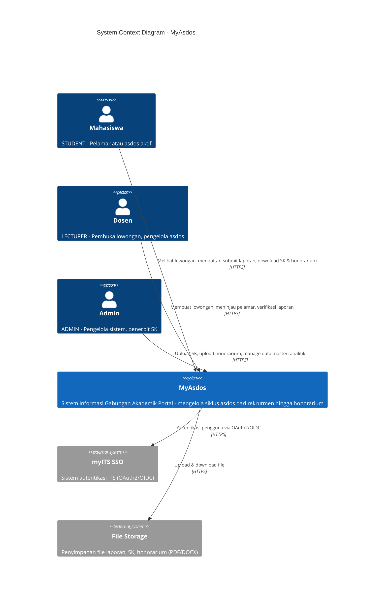
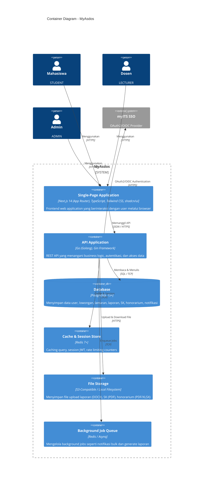
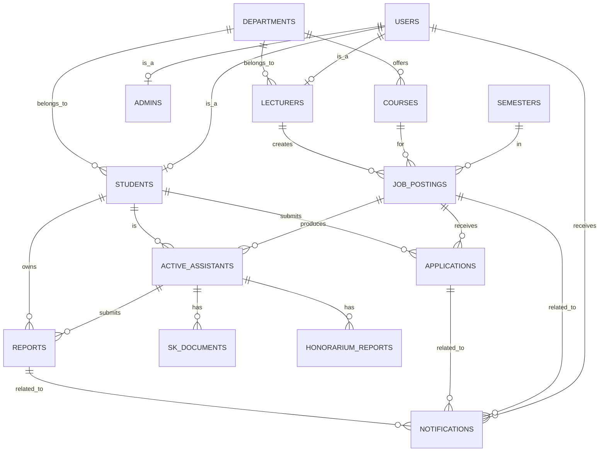

# Software Architecture Design (SAD)

## MyAsdos — Sistem Informasi Gabungan Akademik Portal

## Daftar Isi

1. [Pendahuluan](#1-pendahuluan)
2. [Architectural Drivers](#2-architectural-drivers)
3. [Architectural Pattern](#3-architectural-pattern)
4. [System Context (C4 Level 1)](#4-system-context-c4-level-1)
5. [Container Diagram (C4 Level 2)](#5-container-diagram-c4-level-2)
6. [Component Diagram (C4 Level 3)](#6-component-diagram-c4-level-3)
7. [Frontend Architecture](#7-frontend-architecture)
8. [Database Design](#8-database-design)
9. [API Design](#9-api-design)
10. [Authentication & Authorization](#10-authentication--authorization)
11. [File Storage Strategy](#11-file-storage-strategy)
12. [Notification/Event System](#12-notificationevent-system)
13. [Scalability](#13-scalability)
14. [Availability & Performance](#14-availability--performance)
15. [Security Architecture](#15-security-architecture)

---

## 1. Pendahuluan

### 1.1 Tujuan Dokumen

Dokumen Software Architecture Design (SAD) ini mendefinisikan arsitektur teknis untuk sistem **MyAsdos**, sebuah platform web yang mengintegrasikan seluruh siklus administrasi Asisten Dosen (Asdos) di Institut Teknologi Sepuluh Nopember (ITS). Dokumen ini menjadi panduan implementasi tim pengembang dan acuan review teknis untuk dosen penguji.

### 1.2 Ruang Lingkup

Dokumen ini mencakup:

- Petaan arsitektur tinggi (C4 Model: System Context, Container, Component)
- Detail teknologi yang digunakan beserta justifikasi pemilihan
- Desain basis data relasional (PostgreSQL)
- Spesifikasi API RESTful per modul (M1-M9)
- Alur autentikasi SSO myITS (OAuth2/OIDC)
- Strategi file storage, caching, notifikasi, dan keamanan
- Aspek non-fungsional: _scalability_, _availability_, _performance_, dan _security_

---

## 2. Architectural Drivers

### 2.1 Business Goals

1. **Integrasi Proses Akademik**: Menyatukan rekrutmen, pelaporan, penerbitan SK, dan pencairan honorarium asdos dalam satu sistem terpusat.
2. **Efisiensi Administrasi**: Mengurangi overhead manual dosen, admin, dan mahasiswa dalam mengelola asdos.
3. **Transparansi**: Mahasiswa dapat melacak status lamaran, laporan, dan honorarium secara real-time.

### 2.2 Technical Constraints

| Constraint         | Deskripsi                                                                                     |
| ------------------ | --------------------------------------------------------------------------------------------- |
| **Single Sign-On** | Wajib menggunakan myITS SSO (OAuth2/OIDC). Tidak ada autentikasi lokal berbasis password.     |
| **File Upload**    | Sistem harus menangani upload file DOCX dan PDF (laporan, SK, honorarium).                    |
| **Web Platform**   | Aplikasi berbasis web, harus responsif di desktop dan mobile (responsive design).             |
| **Integrasi Data** | Data mata kuliah, jurusan, dan semester diinput oleh admin, bukan dari myITS secara otomatis. |

### 2.3 Quality Attributes (Non-Functional Requirements)

| Quality Attribute   | Prioritas     | Strategi                                                                    |
| ------------------- | ------------- | --------------------------------------------------------------------------- |
| **Scalability**     | Tinggi        | Stateless backend, horizontal scaling, caching dengan Redis.                |
| **Availability**    | Tinggi        | Health checks, connection pooling, graceful degradation.                    |
| **Performance**     | Tinggi        | Database indexing, pagination, Redis caching, CDN untuk static assets.      |
| **Security**        | Sangat Tinggi | RBAC, JWT, HTTPS, input validation, CORS, rate limiting, XSS prevention.    |
| **Maintainability** | Tinggi        | Layered architecture, clean code principles, TypeScript & Go strong typing. |
| **Usability**       | Tinggi        | Modern UI dengan shadcn/ui, konsistensi desain, feedback interaktif.        |

---

## 3. Architectural Pattern

### 3.1 Pattern Utama: Layered Architecture + Client-Server

Sistem MyAsdos mengadopsi **Layered Architecture** untuk backend dan **Client-Server Architecture** untuk pemisahan frontend-backend. Pemisahan ini memungkinkan tim FE dan BE untuk bekerja secara paralel, serta memudahkan scaling di masa depan.

```
┌────────────────────────────────────────────────────────────┐
│                    CLIENT LAYER                            │
│  ┌──────────────────────────────────────────────────────┐  │
│  │  Presentation Layer (Next.js + React + shadcn/ui)    │  │
│  │  - Pages & Components                                │  │
│  │  - State Management (React Context / Zustand)        │  │
│  │  - API Client (Axios / Fetch)                        │  │
│  └──────────────────────────────────────────────────────┘  │
└────────────────────────────────────────────────────────────┘
                              │ HTTPS / REST JSON
                              ▼
┌────────────────────────────────────────────────────────────┐
│                   SERVER LAYER (Go + Gin)                  │
│  ┌──────────────────────────────────────────────────────┐  │
│  │  Application Layer (Gin Handlers)                    │  │
│  │  - HTTP Controllers / Handlers                       │  │
│  │  - Middleware (Auth, CORS, Logging, Rate Limit)      │  │
│  │  - DTO (Request / Response structs)                  │  │
│  └──────────────────────────────────────────────────────┘  │
│  ┌──────────────────────────────────────────────────────┐  │
│  │  Domain Layer (Business Logic / Services)            │  │
│  │  - Entities (User, JobPosting, Application, Report)  │  │
│  │  - Use Cases / Services (Apply, Approve, Verify)     │  │
│  │  - Domain Rules & Validations                        │  │
│  └──────────────────────────────────────────────────────┘  │
│  ┌──────────────────────────────────────────────────────┐  │
│  │  Infrastructure Layer (Repositories & External)      │  │
│  │  - Repository (PostgreSQL via GORM / sqlx)           │  │
│  │  - File Storage (Local / S3-Compatible)              │  │
│  │  - Cache (Redis)                                     │  │
│  │  - Notification Service (Event-triggered)            │  │
│  └──────────────────────────────────────────────────────┘  │
└────────────────────────────────────────────────────────────┘
```

### 3.2 Justifikasi Pemilihan Pattern

| Pattern                            | Alasan Pemilihan                                                                                                       |
| ---------------------------------- | ---------------------------------------------------------------------------------------------------------------------- |
| **Layered Architecture**           | Memisahkan concerns (presentasi, bisnis, data), memudahkan testing, maintenance, dan pemahaman kode bagi tim akademik. |
| **Client-Server (FE/BE terpisah)** | Frontend dapat di-deploy secara independen, backend bersifat stateless sehingga mudah di-scale.                        |
| **Repository Pattern**             | Mengabstraksi akses data, memudahkan penggantian DB atau mocking untuk unit test.                                      |
| **DTO Pattern**                    | Memisahkan struktur data API dari entity database, meningkatkan keamanan dan fleksibilitas.                            |

---

## 4. System Context (C4 Level 1)

Diagram ini menunjukkan interaksi sistem MyAsdos dengan aktor dan sistem eksternal.



### Deskripsi Interaksi:

- **Mahasiswa**: Melihat lowongan, mendaftar asdos, melihat status lamaran, submit laporan tugas & rencana kerja, mengunduh SK dan laporan honorarium.
- **Dosen**: Membuat dan mengelola lowongan, meninjau serta memutuskan pelamar, memverifikasi laporan asdos.
- **Admin**: Mengelola data master (mata kuliah, semester, jurusan), menerbitkan SK digital, mengunggah laporan honorarium, melihat dashboard analitik.
- **myITS SSO**: Sistem eksternal untuk autentikasi pengguna. MyAsdos tidak menyimpan password pengguna.
- **File Storage**: Penyimpanan eksternal untuk file laporan (DOCX), SK (PDF), dan honorarium (PDF/XLSX).

---

## 5. Container Diagram (C4 Level 2)

Diagram ini menunjukkan container-container teknologi utama yang membentuk sistem MyAsdos.



### Deskripsi Container:

| Container                   | Teknologi                                                    | Fungsi                                                                                                                                          |
| --------------------------- | ------------------------------------------------------------ | ----------------------------------------------------------------------------------------------------------------------------------------------- |
| **Single-Page Application** | Next.js 14 (App Router), TypeScript, Tailwind CSS, shadcn/ui | Frontend yang dirender di browser. Menggunakan SSR untuk halaman publik dan CSR untuk dashboard. Menyediakan UI interaktif untuk seluruh aktor. |
| **API Application**         | Go 1.22+, Gin Framework                                      | REST API stateless yang menangani seluruh business logic. Mengelola autentikasi JWT, validasi, CRUD operations, dan koordinasi antar layer.     |
| **Database**                | PostgreSQL 15+                                               | Relational database utama. Menyimpan seluruh data transaksional dengan ACID compliance.                                                         |
| **Cache & Session Store**   | Redis 7+                                                     | In-memory cache untuk mengurangi beban DB (query lowongan populer), menyimpan session token, dan rate limiting.                                 |
| **File Storage**            | S3-Compatible (MinIO) / Local                                | Object storage untuk file laporan (DOCX), SK (PDF), dan honorarium (PDF/XLSX).                                                                  |
| **Background Job Queue**    | Redis + Asynq (Go library)                                   | Mengelola pekerjaan asynchronous seperti mengirim notifikasi bulk, generate laporan PDF, dan cleanup file expired.                              |

---

## 6. Component Diagram (C4 Level 3)

Diagram ini mendetailkan komponen internal di dalam **API Application** (Go + Gin).

```mermaid
C4Component
    title Component Diagram - API Application (Backend)

    Container(spa, "SPA (Next.js)", "TypeScript, React", "Frontend Application")

    Container_Boundary(api, "API Application (Go + Gin)") {
        Component(auth_handler, "Auth Handler", "Go / Gin", "Menangani login SSO, logout, refresh token, callback OAuth")
        Component(user_handler, "User Handler", "Go / Gin", "CRUD profil user, upload foto profil")
        Component(job_handler, "Job Handler", "Go / Gin", "CRUD lowongan asdos, filter & pencarian")
        Component(app_handler, "Application Handler", "Go / Gin", "Submit lamaran, tarik lamaran, lihat status")
        Component(report_handler, "Report Handler", "Go / Gin", "Submit laporan, download template, lihat feedback")
        Component(sk_handler, "SK Handler", "Go / Gin", "Upload & download SK digital")
        Component(honor_handler, "Honorarium Handler", "Go / Gin", "Upload & download laporan honorarium")
        Component(notif_handler, "Notification Handler", "Go / Gin", "List notifikasi, tandai dibaca, hapus")
        Component(dash_handler, "Dashboard Handler", "Go / Gin", "Aggregasi data untuk admin dashboard")

        Component(middleware, "Middleware Layer", "Go / Gin", "JWT validation, CORS, rate limiting, RBAC enforcement, request logging")

        Component(auth_service, "Auth Service", "Go", "OAuth2/OIDC flow, JWT generation & validation, session management")
        Component(user_service, "User Service", "Go", "Business logic manajemen user dan profil")
        Component(job_service, "Job Service", "Go", "Business logic lowongan, validasi kuota, status transitions")
        Component(app_service, "Application Service", "Go", "Business logic lamaran, state machine, validasi duplikat")
        Component(report_service, "Report Service", "Go", "Business logic laporan, validasi file, status approval")
        Component(doc_service, "Document Service", "Go", "Business logic upload & download file SK & honorarium")
        Component(notif_service, "Notification Service", "Go", "Business logic notifikasi, trigger events")
        Component(dash_service, "Dashboard Service", "Go", "Aggregasi query untuk metrik admin")

        Component(user_repo, "User Repository", "Go / GORM", "Akses data tabel users, students, lecturers")
        Component(job_repo, "Job Repository", "Go / GORM", "Akses data tabel job_postings")
        Component(app_repo, "Application Repository", "Go / GORM", "Akses data tabel applications")
        Component(report_repo, "Report Repository", "Go / GORM", "Akses data tabel reports")
        Component(doc_repo, "Document Repository", "Go / GORM", "Akses data tabel sk_documents, honorarium_reports")
        Component(notif_repo, "Notification Repository", "Go / GORM", "Akses data tabel notifications")
    }

    ContainerDb(db, "PostgreSQL", "PostgreSQL 15+", "Database")
    Container(cache, "Redis", "Redis 7+", "Cache & Session")
    Container(filestore, "File Storage", "S3 / Local", "File Storage")
    System_Ext(myits, "myITS SSO", "OAuth2/OIDC")

    Rel(spa, auth_handler, "Login / Logout / Callback", "HTTPS / JSON")
    Rel(spa, user_handler, "Profil", "HTTPS / JSON")
    Rel(spa, job_handler, "Lowongan", "HTTPS / JSON")
    Rel(spa, app_handler, "Lamaran", "HTTPS / JSON")
    Rel(spa, report_handler, "Laporan", "HTTPS / JSON")
    Rel(spa, sk_handler, "SK", "HTTPS / JSON")
    Rel(spa, honor_handler, "Honorarium", "HTTPS / JSON")
    Rel(spa, notif_handler, "Notifikasi", "HTTPS / JSON")
    Rel(spa, dash_handler, "Dashboard", "HTTPS / JSON")

    Rel(auth_handler, middleware, "Menggunakan", "Go")
    Rel(user_handler, middleware, "Menggunakan", "Go")
    Rel(job_handler, middleware, "Menggunakan", "Go")
    Rel(app_handler, middleware, "Menggunakan", "Go")
    Rel(report_handler, middleware, "Menggunakan", "Go")
    Rel(sk_handler, middleware, "Menggunakan", "Go")
    Rel(honor_handler, middleware, "Menggunakan", "Go")
    Rel(notif_handler, middleware, "Menggunakan", "Go")
    Rel(dash_handler, middleware, "Menggunakan", "Go")

    Rel(auth_handler, auth_service, "Menggunakan", "Go")
    Rel(user_handler, user_service, "Menggunakan", "Go")
    Rel(job_handler, job_service, "Menggunakan", "Go")
    Rel(app_handler, app_service, "Menggunakan", "Go")
    Rel(report_handler, report_service, "Menggunakan", "Go")
    Rel(sk_handler, doc_service, "Menggunakan", "Go")
    Rel(honor_handler, doc_service, "Menggunakan", "Go")
    Rel(notif_handler, notif_service, "Menggunakan", "Go")
    Rel(dash_handler, dash_service, "Menggunakan", "Go")

    Rel(app_service, notif_service, "Trigger notifikasi", "Go")
    Rel(report_service, notif_service, "Trigger notifikasi", "Go")
    Rel(job_service, notif_service, "Trigger notifikasi", "Go")
    Rel(doc_service, notif_service, "Trigger notifikasi", "Go")

    Rel(auth_service, user_repo, "Menggunakan", "Go")
    Rel(user_service, user_repo, "Menggunakan", "Go")
    Rel(job_service, job_repo, "Menggunakan", "Go")
    Rel(app_service, app_repo, "Menggunakan", "Go")
    Rel(report_service, report_repo, "Menggunakan", "Go")
    Rel(doc_service, doc_repo, "Menggunakan", "Go")
    Rel(notif_service, notif_repo, "Menggunakan", "Go")
    Rel(dash_service, user_repo, "Menggunakan", "Go")
    Rel(dash_service, job_repo, "Menggunakan", "Go")
    Rel(dash_service, app_repo, "Menggunakan", "Go")

    Rel(user_repo, db, "Read / Write", "SQL / TCP")
    Rel(job_repo, db, "Read / Write", "SQL / TCP")
    Rel(app_repo, db, "Read / Write", "SQL / TCP")
    Rel(report_repo, db, "Read / Write", "SQL / TCP")
    Rel(doc_repo, db, "Read / Write", "SQL / TCP")
    Rel(notif_repo, db, "Read / Write", "SQL / TCP")

    Rel(auth_service, myits, "OAuth2 / OIDC", "HTTPS")
    Rel(auth_service, cache, "Session / JWT", "TCP")
    Rel(doc_service, filestore, "Upload / Download", "HTTPS")
```



### Penjelasan Alur Data (Apply → Accept → Report):

1. **Mahasiswa mendaftar lowongan**: `SPA → app_handler → middleware (JWT + RBAC) → app_service`.
   - `app_service` validasi bisnis (tidak duplikat, lowongan OPEN) → `app_repo` simpan ke DB → trigger `notif_service` ke dosen.
2. **Dosen menerima pelamar**: `SPA → app_handler → middleware → app_service`.
   - Update status lamaran → buat record `active_assistants` via `job_service`/`user_repo` → trigger notifikasi ke mahasiswa.
3. **Asdos submit laporan**: `SPA → report_handler → middleware → report_service`.
   - Validasi file DOCX (MIME, size) → `report_repo` simpan metadata ke DB, `doc_service` simpan file ke storage → trigger notifikasi ke dosen.
4. **Dosen verifikasi laporan**: `SPA → report_handler → middleware → report_service`.
   - Update status (APPROVED/REVISION/REJECTED) → `report_repo` update DB → trigger notifikasi ke asdos.

---

## 7. Frontend Architecture

### 7.1 Tech Stack Frontend

| Teknologi        | Versi            | Fungsi                                | Justifikasi                                                                            |
| ---------------- | ---------------- | ------------------------------------- | -------------------------------------------------------------------------------------- |
| **Next.js**      | 14+ (App Router) | Framework React dengan SSR/SSG        | SEO-friendly, performa optimal, routing otomatis, API Routes internal jika diperlukan. |
| **TypeScript**   | 5.x              | Static typing untuk JavaScript        | Menghindari bug runtime, autocomplete IDE, maintainability tinggi.                     |
| **Tailwind CSS** | 3.4+             | Utility-first CSS framework           | Pengembangan UI cepat, konsistensi desain, file CSS tidak membesar.                    |
| **shadcn/ui**    | Latest           | Komponen UI berbasis Radix + Tailwind | Komponen accessible, customizable, tidak terikat library UI monolitik (seperti MUI).   |

### 7.2 Struktur Direktori Frontend (Next.js App Router)

```
myasdos-frontend/
├── app/
│   ├── (auth)/
│   │   └── login/               # Halaman login / callback SSO
│   ├── (dashboard)/
│   │   ├── student/
│   │   │   ├── jobs/            # Browse & detail lowongan (M2)
│   │   │   ├── applications/    # Kelola lamaran (M3)
│   │   │   ├── reports/         # Submit & lihat laporan (M5)
│   │   │   ├── sk/              # Download SK (M6)
│   │   │   ├── honorarium/      # Download honorarium (M7)
│   │   │   └── profile/         # Edit profil (M1)
│   │   ├── lecturer/
│   │   │   ├── jobs/            # CRUD lowongan (M2)
│   │   │   ├── applications/    # Tinjau pelamar (M3)
│   │   │   ├── assistants/      # Lihat asdos aktif (M4)
│   │   │   ├── reports/         # Verifikasi laporan (M5)
│   │   │   ├── sk/              # Download SK asdos (M6)
│   │   │   └── profile/         # Edit profil (M1)
│   │   └── admin/
│   │       ├── dashboard/       # Dashboard analitik (M9)
│   │       ├── users/           # Manajemen akun
│   │       ├── master-data/     # Mata kuliah, jurusan, semester
│   │       ├── sk/              # Upload SK (M6)
│   │       ├── honorarium/      # Upload honorarium (M7)
│   │       └── profile/
│   ├── api/                     # API Routes internal (jika diperlukan)
│   └── layout.tsx               # Root layout (Provider, Theme)
├── components/
│   ├── ui/                      # Komponen shadcn/ui (Button, Card, Dialog, Table, Form, dll)
│   ├── layout/                  # Navbar, Sidebar, Footer
│   └── shared/                  # Komponen reusable (DataTable, Pagination, FileUploader)
├── hooks/                       # Custom React hooks (useAuth, useJobs, useApplications)
├── lib/
│   ├── api.ts                   # Axios instance dengan interceptor JWT
│   ├── auth.ts                  # Helper auth (login, logout, parse JWT)
│   └── utils.ts                 # Utility functions (cn, formatDate, dll)
├── types/                       # TypeScript interfaces (User, JobPosting, Application, dll)
├── public/                      # Static assets (logo, icons, template DOCX)
└── styles/
    └── globals.css              # Tailwind directives + custom CSS
```

### 7.3 State Management & Data Fetching

| Aspek            | Strategi                                                                                |
| ---------------- | --------------------------------------------------------------------------------------- |
| **Global State** | **Zustand** (lightweight, no boilerplate) untuk auth session, notifikasi unread count.  |
| **Server State** | **React Query (TanStack Query)** untuk fetching, caching, dan invalidasi data dari API. |
| **Form State**   | **React Hook Form** + **Zod** untuk validasi schema form (lamaran, laporan, dll).       |
| **Routing**      | Next.js App Router dengan parallel routes untuk layout sidebar + main content.          |

### 7.4 UI/UX Design System (shadcn/ui)

Komponen utama yang digunakan dari shadcn/ui:

- **Layout**: `Card`, `Tabs`, `Sheet` (mobile sidebar), `ScrollArea`
- **Form**: `Input`, `Textarea`, `Select`, `DatePicker`, `FileUpload` (custom), `Form`
- **Feedback**: `Toast` / `Sonner`, `Alert`, `Dialog`, `Skeleton`
- **Data Display**: `Table`, `DataTable` (dari `@tanstack/react-table`), `Badge`, `Avatar`
- **Navigation**: `Breadcrumb`, `Pagination`, `Command` (search bar)

---

## 8. Database Design

### 8.1 ERD (Entity Relationship Diagram)



### 8.2 Skema Tabel PostgreSQL

#### Tabel: `users`

Menyimpan data dasar semua pengguna (STUDENT, LECTURER, ADMIN).

| Kolom          | Tipe                                   | Constraint         | Deskripsi           |
| -------------- | -------------------------------------- | ------------------ | ------------------- |
| `id`           | `UUID`                                 | `PRIMARY KEY`      | Identitas unik user |
| `myits_id`     | `VARCHAR(50)`                          | `UNIQUE, NOT NULL` | ID dari myITS SSO   |
| `email`        | `VARCHAR(255)`                         | `UNIQUE, NOT NULL` | Email ITS           |
| `name`         | `VARCHAR(255)`                         | `NOT NULL`         | Nama lengkap        |
| `role`         | `ENUM('STUDENT', 'LECTURER', 'ADMIN')` | `NOT NULL`         | Role pengguna       |
| `status`       | `ENUM('ACTIVE', 'SUSPENDED')`          | `DEFAULT 'ACTIVE'` | Status akun         |
| `avatar_url`   | `VARCHAR(500)`                         | `NULL`             | URL foto profil     |
| `phone_number` | `VARCHAR(20)`                          | `NULL`             | Nomor telepon       |
| `created_at`   | `TIMESTAMPTZ`                          | `DEFAULT NOW()`    | Waktu pembuatan     |
| `updated_at`   | `TIMESTAMPTZ`                          | `DEFAULT NOW()`    | Waktu update        |

**Index:** `idx_users_myits_id`, `idx_users_role`, `idx_users_status`

#### Tabel: `students` (Extends `users`)

| Kolom           | Tipe           | Constraint                      | Deskripsi                           |
| --------------- | -------------- | ------------------------------- | ----------------------------------- |
| `user_id`       | `UUID`         | `PRIMARY KEY, FK → users.id`    | Referensi ke users                  |
| `nrp`           | `VARCHAR(20)`  | `UNIQUE, NOT NULL`              | Nomor Registrasi Pokok              |
| `department_id` | `UUID`         | `FK → departments.id, NOT NULL` | Jurusan                             |
| `bio`           | `TEXT`         | `NULL`                          | Bio singkat                         |
| `portfolio_url` | `VARCHAR(500)` | `NULL`                          | Link portofolio / CV                |
| `gpa`           | `DECIMAL(3,2)` | `NULL`                          | IPK (opsional, dari data eksternal) |
| `semester`      | `INT`          | `NULL`                          | Semester kuliah saat ini            |

**Index:** `idx_students_nrp`, `idx_students_department_id`

#### Tabel: `lecturers` (Extends `users`)

| Kolom           | Tipe          | Constraint                      | Deskripsi           |
| --------------- | ------------- | ------------------------------- | ------------------- |
| `user_id`       | `UUID`        | `PRIMARY KEY, FK → users.id`    | Referensi ke users  |
| `nip`           | `VARCHAR(20)` | `UNIQUE, NOT NULL`              | Nomor Induk Pegawai |
| `department_id` | `UUID`        | `FK → departments.id, NOT NULL` | Jurusan             |

**Index:** `idx_lecturers_nip`, `idx_lecturers_department_id`

#### Tabel: `admins` (Extends `users`)

| Kolom         | Tipe                       | Constraint                   | Deskripsi          |
| ------------- | -------------------------- | ---------------------------- | ------------------ |
| `user_id`     | `UUID`                     | `PRIMARY KEY, FK → users.id` | Referensi ke users |
| `admin_level` | `ENUM('SUPER', 'REGULAR')` | `DEFAULT 'REGULAR'`          | Level admin        |

#### Tabel: `departments`

| Kolom     | Tipe           | Constraint         | Deskripsi                       |
| --------- | -------------- | ------------------ | ------------------------------- |
| `id`      | `UUID`         | `PRIMARY KEY`      | ID unik                         |
| `code`    | `VARCHAR(10)`  | `UNIQUE, NOT NULL` | Kode jurusan (e.g., 'IF', 'TI') |
| `name`    | `VARCHAR(255)` | `NOT NULL`         | Nama jurusan                    |
| `faculty` | `VARCHAR(255)` | `NOT NULL`         | Nama fakultas                   |

#### Tabel: `courses`

| Kolom           | Tipe           | Constraint                      | Deskripsi        |
| --------------- | -------------- | ------------------------------- | ---------------- |
| `id`            | `UUID`         | `PRIMARY KEY`                   | ID unik          |
| `department_id` | `UUID`         | `FK → departments.id, NOT NULL` | Jurusan pemilik  |
| `code`          | `VARCHAR(20)`  | `NOT NULL`                      | Kode mata kuliah |
| `name`          | `VARCHAR(255)` | `NOT NULL`                      | Nama mata kuliah |
| `credits`       | `INT`          | `DEFAULT 0`                     | SKS              |

**Index:** `idx_courses_department_id`

#### Tabel: `semesters`

| Kolom           | Tipe                      | Constraint      | Deskripsi                          |
| --------------- | ------------------------- | --------------- | ---------------------------------- |
| `id`            | `UUID`                    | `PRIMARY KEY`   | ID unik                            |
| `academic_year` | `VARCHAR(10)`             | `NOT NULL`      | Tahun akademik (e.g., '2024/2025') |
| `term`          | `ENUM('GANJIL', 'GENAP')` | `NOT NULL`      | Semester                           |
| `is_active`     | `BOOLEAN`                 | `DEFAULT FALSE` | Semester aktif saat ini            |

**Index:** `idx_semesters_active`

#### Tabel: `job_postings` (Lowongan Asdos)

| Kolom          | Tipe                             | Constraint                         | Deskripsi           |
| -------------- | -------------------------------- | ---------------------------------- | ------------------- |
| `id`           | `UUID`                           | `PRIMARY KEY`                      | ID unik             |
| `lecturer_id`  | `UUID`                           | `FK → lecturers.user_id, NOT NULL` | Dosen pemilik       |
| `course_id`    | `UUID`                           | `FK → courses.id, NOT NULL`        | Mata kuliah         |
| `semester_id`  | `UUID`                           | `FK → semesters.id, NOT NULL`      | Semester            |
| `description`  | `TEXT`                           | `NULL`                             | Deskripsi tugas     |
| `requirements` | `TEXT`                           | `NULL`                             | Persyaratan pelamar |
| `quota`        | `INT`                            | `NOT NULL`                         | Jumlah kuota asdos  |
| `status`       | `ENUM('OPEN', 'FULL', 'CLOSED')` | `DEFAULT 'OPEN'`                   | Status lowongan     |
| `open_date`    | `DATE`                           | `NOT NULL`                         | Tanggal buka        |
| `close_date`   | `DATE`                           | `NOT NULL`                         | Tanggal tutup       |
| `notes`        | `TEXT`                           | `NULL`                             | Catatan tambahan    |
| `created_at`   | `TIMESTAMPTZ`                    | `DEFAULT NOW()`                    | Waktu pembuatan     |
| `updated_at`   | `TIMESTAMPTZ`                    | `DEFAULT NOW()`                    | Waktu update        |

**Index:** `idx_job_postings_status`, `idx_job_postings_lecturer_id`, `idx_job_postings_course_id`, `idx_job_postings_semester_id`, `idx_job_postings_dates`

#### Tabel: `applications` (Lamaran)

| Kolom             | Tipe                                                               | Constraint                        | Deskripsi                        |
| ----------------- | ------------------------------------------------------------------ | --------------------------------- | -------------------------------- |
| `id`              | `UUID`                                                             | `PRIMARY KEY`                     | ID unik                          |
| `job_posting_id`  | `UUID`                                                             | `FK → job_postings.id, NOT NULL`  | Lowongan yang dilamar            |
| `student_id`      | `UUID`                                                             | `FK → students.user_id, NOT NULL` | Mahasiswa pelamar                |
| `reason`          | `TEXT`                                                             | `NOT NULL`                        | Alasan mendaftar                 |
| `cv_url`          | `VARCHAR(500)`                                                     | `NULL`                            | URL file CV                      |
| `additional_data` | `JSONB`                                                            | `NULL`                            | Data tambahan sesuai persyaratan |
| `status`          | `ENUM('PENDING', 'REVIEWED', 'ACCEPTED', 'REJECTED', 'WITHDRAWN')` | `DEFAULT 'PENDING'`               | Status lamaran                   |
| `lecturer_notes`  | `TEXT`                                                             | `NULL`                            | Catatan dosen (jika rejected)    |
| `applied_at`      | `TIMESTAMPTZ`                                                      | `DEFAULT NOW()`                   | Waktu melamar                    |
| `decided_at`      | `TIMESTAMPTZ`                                                      | `NULL`                            | Waktu keputusan                  |

**Index:** `idx_applications_job_posting_id`, `idx_applications_student_id`, `idx_applications_status`, `idx_applications_unique` (`UNIQUE(job_posting_id, student_id)`)

#### Tabel: `active_assistants` (Asdos Aktif)

| Kolom            | Tipe          | Constraint                        | Deskripsi       |
| ---------------- | ------------- | --------------------------------- | --------------- |
| `id`             | `UUID`        | `PRIMARY KEY`                     | ID unik         |
| `job_posting_id` | `UUID`        | `FK → job_postings.id, NOT NULL`  | Lowongan asal   |
| `student_id`     | `UUID`        | `FK → students.user_id, NOT NULL` | Mahasiswa asdos |
| `semester_id`    | `UUID`        | `FK → semesters.id, NOT NULL`     | Semester aktif  |
| `started_at`     | `TIMESTAMPTZ` | `DEFAULT NOW()`                   | Waktu mulai     |
| `ended_at`       | `TIMESTAMPTZ` | `NULL`                            | Waktu selesai   |
| `is_active`      | `BOOLEAN`     | `DEFAULT TRUE`                    | Status aktif    |

**Index:** `idx_active_assistants_student_id`, `idx_active_assistants_semester_id`, `idx_active_assistants_job_posting_id`

#### Tabel: `reports` (Laporan Tanggung Jawab & Rencana Kerja)

| Kolom                 | Tipe                                                    | Constraint                            | Deskripsi                          |
| --------------------- | ------------------------------------------------------- | ------------------------------------- | ---------------------------------- |
| `id`                  | `UUID`                                                  | `PRIMARY KEY`                         | ID unik                            |
| `active_assistant_id` | `UUID`                                                  | `FK → active_assistants.id, NOT NULL` | Asdos yang melaporkan              |
| `type`                | `ENUM('TANGGUNG_JAWAB', 'RENCANA_KERJA')`               | `NOT NULL`                            | Jenis laporan                      |
| `period`              | `VARCHAR(50)`                                           | `NOT NULL`                            | Periode laporan (e.g., "Minggu 1") |
| `file_url`            | `VARCHAR(500)`                                          | `NOT NULL`                            | URL file DOCX                      |
| `status`              | `ENUM('SUBMITTED', 'APPROVED', 'REVISION', 'REJECTED')` | `DEFAULT 'SUBMITTED'`                 | Status laporan                     |
| `feedback`            | `TEXT`                                                  | `NULL`                                | Feedback/catatan dosen             |
| `verified_file_url`   | `VARCHAR(500)`                                          | `NULL`                                | URL file hasil verifikasi PDF      |
| `submitted_at`        | `TIMESTAMPTZ`                                           | `DEFAULT NOW()`                       | Waktu submit                       |
| `verified_at`         | `TIMESTAMPTZ`                                           | `NULL`                                | Waktu verifikasi                   |

**Index:** `idx_reports_active_assistant_id`, `idx_reports_status`, `idx_reports_type`

#### Tabel: `sk_documents` (SK Digital)

| Kolom                 | Tipe           | Constraint                            | Deskripsi               |
| --------------------- | -------------- | ------------------------------------- | ----------------------- |
| `id`                  | `UUID`         | `PRIMARY KEY`                         | ID unik                 |
| `active_assistant_id` | `UUID`         | `FK → active_assistants.id, NOT NULL` | Asdos yang bersangkutan |
| `file_url`            | `VARCHAR(500)` | `NOT NULL`                            | URL file SK PDF         |
| `issued_by`           | `UUID`         | `FK → admins.user_id, NOT NULL`       | Admin penerbit          |
| `issued_at`           | `TIMESTAMPTZ`  | `DEFAULT NOW()`                       | Waktu penerbitan        |

**Index:** `idx_sk_documents_active_assistant_id`

#### Tabel: `honorarium_reports` (Laporan Pencairan Honorarium)

| Kolom                 | Tipe           | Constraint                            | Deskripsi                   |
| --------------------- | -------------- | ------------------------------------- | --------------------------- |
| `id`                  | `UUID`         | `PRIMARY KEY`                         | ID unik                     |
| `active_assistant_id` | `UUID`         | `FK → active_assistants.id, NOT NULL` | Asdos yang bersangkutan     |
| `period`              | `VARCHAR(50)`  | `NOT NULL`                            | Periode pencairan           |
| `file_url`            | `VARCHAR(500)` | `NOT NULL`                            | URL file laporan (PDF/XLSX) |
| `uploaded_by`         | `UUID`         | `FK → admins.user_id, NOT NULL`       | Admin pengunggah            |
| `uploaded_at`         | `TIMESTAMPTZ`  | `DEFAULT NOW()`                       | Waktu upload                |

**Index:** `idx_honorarium_reports_active_assistant_id`

#### Tabel: `notifications` (Notifikasi In-Platform)

| Kolom                 | Tipe           | Constraint                | Deskripsi                                                 |
| --------------------- | -------------- | ------------------------- | --------------------------------------------------------- |
| `id`                  | `UUID`         | `PRIMARY KEY`             | ID unik                                                   |
| `user_id`             | `UUID`         | `FK → users.id, NOT NULL` | Penerima notifikasi                                       |
| `type`                | `ENUM(...)`    | `NOT NULL`                | Tipe notifikasi (lihat M8 PRD)                            |
| `title`               | `VARCHAR(255)` | `NOT NULL`                | Judul notifikasi                                          |
| `message`             | `TEXT`         | `NOT NULL`                | Isi notifikasi                                            |
| `related_entity_type` | `VARCHAR(50)`  | `NULL`                    | Tipe entitas terkait (e.g., 'JOB_POSTING', 'APPLICATION') |
| `related_entity_id`   | `UUID`         | `NULL`                    | ID entitas terkait                                        |
| `is_read`             | `BOOLEAN`      | `DEFAULT FALSE`           | Sudah dibaca?                                             |
| `created_at`          | `TIMESTAMPTZ`  | `DEFAULT NOW()`           | Waktu pembuatan                                           |

**Index:** `idx_notifications_user_id`, `idx_notifications_is_read`, `idx_notifications_created_at`

---

## 9. API Design

### 9.1 Base URL & Konvensi

- **Base URL**: `https://api.myasdos.its.ac.id/v1`
- **Format Response**:
  ```json
  {
    "success": true,
    "message": "Operation successful",
    "data": { ... },
    "meta": { "page": 1, "limit": 20, "total": 100 }
  }
  ```
- **Autentikasi**: Header `Authorization: Bearer <JWT_TOKEN>`
- **Rate Limiting**: 100 requests/minute per IP, 1000 requests/hour per user.

### 9.2 Endpoint per Modul

#### M1 — Autentikasi & Manajemen Akun

| Method | Endpoint             | Auth   | Deskripsi                                     |
| ------ | -------------------- | ------ | --------------------------------------------- |
| `GET`  | `/auth/sso/login`    | Public | Redirect ke myITS SSO authorization endpoint  |
| `GET`  | `/auth/sso/callback` | Public | Callback dari myITS, exchange code → JWT      |
| `POST` | `/auth/refresh`      | JWT    | Refresh access token                          |
| `POST` | `/auth/logout`       | JWT    | Logout, invalidate session                    |
| `GET`  | `/users/me`          | JWT    | Get profil user yang sedang login             |
| `PUT`  | `/users/me`          | JWT    | Update profil (foto, telepon, bio, portfolio) |
| `POST` | `/users/me/avatar`   | JWT    | Upload foto profil                            |

#### M2 — Job Portal Lowongan Asdos

| Method   | Endpoint               | Auth (Role)            | Deskripsi                                                            |
| -------- | ---------------------- | ---------------------- | -------------------------------------------------------------------- |
| `GET`    | `/jobs`                | Public / JWT           | List lowongan (filter: status, department, course, semester, search) |
| `GET`    | `/jobs/:id`            | Public / JWT           | Detail lowongan                                                      |
| `POST`   | `/jobs`                | JWT (LECTURER)         | Buat lowongan baru                                                   |
| `PUT`    | `/jobs/:id`            | JWT (LECTURER - owner) | Edit lowongan (hanya status OPEN)                                    |
| `DELETE` | `/jobs/:id`            | JWT (LECTURER - owner) | Tutup / hapus lowongan                                               |
| `GET`    | `/jobs/:id/applicants` | JWT (LECTURER - owner) | List pelamar untuk lowongan ini                                      |

#### M3 — Manajemen Lamaran

| Method | Endpoint                     | Auth (Role)            | Deskripsi                                    |
| ------ | ---------------------------- | ---------------------- | -------------------------------------------- |
| `POST` | `/applications`              | JWT (STUDENT)          | Submit lamaran ke lowongan                   |
| `GET`  | `/applications`              | JWT (STUDENT)          | List lamaran saya (filter: status, semester) |
| `GET`  | `/applications/:id`          | JWT (STUDENT/LECTURER) | Detail lamaran                               |
| `PUT`  | `/applications/:id/withdraw` | JWT (STUDENT)          | Tarik lamaran (hanya PENDING/REVIEWED)       |
| `PUT`  | `/applications/:id/decide`   | JWT (LECTURER)         | Keputusan: ACCEPTED / REJECTED + catatan     |

#### M4 — Manajemen Asdos Aktif

| Method | Endpoint               | Auth (Role)    | Deskripsi                                  |
| ------ | ---------------------- | -------------- | ------------------------------------------ |
| `GET`  | `/lecturer/assistants` | JWT (LECTURER) | List asdos aktif milik dosen, per semester |
| `GET`  | `/student/history`     | JWT (STUDENT)  | Riwayat pengalaman asdos mahasiswa         |

#### M5 — Sistem Pelaporan Asdos

| Method | Endpoint                     | Auth (Role)            | Deskripsi                                              |
| ------ | ---------------------------- | ---------------------- | ------------------------------------------------------ |
| `POST` | `/reports`                   | JWT (STUDENT)          | Submit laporan (upload DOCX)                           |
| `GET`  | `/reports`                   | JWT (STUDENT)          | List laporan saya                                      |
| `GET`  | `/reports/:id`               | JWT (STUDENT/LECTURER) | Detail laporan                                         |
| `GET`  | `/reports/:id/download`      | JWT (STUDENT/LECTURER) | Download file laporan                                  |
| `PUT`  | `/reports/:id/verify`        | JWT (LECTURER)         | Verifikasi: APPROVED / REVISION / REJECTED + feedback  |
| `POST` | `/reports/:id/verified-file` | JWT (LECTURER)         | Upload file hasil verifikasi PDF (hanya jika APPROVED) |

#### M6 — Penerbitan SK Digital

| Method | Endpoint           | Auth (Role)            | Deskripsi                                 |
| ------ | ------------------ | ---------------------- | ----------------------------------------- |
| `POST` | `/sk`              | JWT (ADMIN)            | Upload SK digital (PDF) untuk asdos aktif |
| `GET`  | `/sk`              | JWT (STUDENT/LECTURER) | List SK yang tersedia                     |
| `GET`  | `/sk/:id/download` | JWT (STUDENT/LECTURER) | Download SK PDF                           |

#### M7 — Informasi Pencairan Honorarium

| Method | Endpoint                   | Auth (Role)   | Deskripsi                           |
| ------ | -------------------------- | ------------- | ----------------------------------- |
| `POST` | `/honorarium`              | JWT (ADMIN)   | Upload laporan pencairan (PDF/XLSX) |
| `GET`  | `/honorarium`              | JWT (STUDENT) | List laporan pencairan              |
| `GET`  | `/honorarium/:id/download` | JWT (STUDENT) | Download laporan                    |

#### M8 — Notifikasi

| Method   | Endpoint                      | Auth | Deskripsi                      |
| -------- | ----------------------------- | ---- | ------------------------------ |
| `GET`    | `/notifications`              | JWT  | List notifikasi user           |
| `PUT`    | `/notifications/:id/read`     | JWT  | Tandai notifikasi dibaca       |
| `PUT`    | `/notifications/read-all`     | JWT  | Tandai semua dibaca            |
| `DELETE` | `/notifications/:id`          | JWT  | Hapus notifikasi               |
| `GET`    | `/notifications/unread-count` | JWT  | Hitung notifikasi belum dibaca |

#### M9 — Dashboard & Analitik Admin

| Method | Endpoint                    | Auth (Role) | Deskripsi                                                                             |
| ------ | --------------------------- | ----------- | ------------------------------------------------------------------------------------- |
| `GET`  | `/admin/dashboard`          | JWT (ADMIN) | Metrik: total user, lowongan aktif, lamaran, asdos per dept, akun suspend, SK pending |
| `GET`  | `/admin/users`              | JWT (ADMIN) | List semua user (filter: role, status, search)                                        |
| `PUT`  | `/admin/users/:id/status`   | JWT (ADMIN) | Update status akun (ACTIVE / SUSPENDED)                                               |
| `GET`  | `/admin/master/departments` | JWT (ADMIN) | CRUD jurusan                                                                          |
| `GET`  | `/admin/master/courses`     | JWT (ADMIN) | CRUD mata kuliah                                                                      |
| `GET`  | `/admin/master/semesters`   | JWT (ADMIN) | CRUD semester                                                                         |

### 9.3 Request/Response Example (Submit Lamaran)

**Request:**

```http
POST /v1/applications
Authorization: Bearer <JWT>
Content-Type: multipart/form-data

job_posting_id: "uuid-lowongan"
reason: "Saya ingin menjadi asdos karena..."
cv_file: <binary>
```

**Response (201 Created):**

```json
{
  "success": true,
  "message": "Lamaran berhasil diajukan",
  "data": {
    "id": "uuid-lamaran",
    "job_posting_id": "uuid-lowongan",
    "student_id": "uuid-student",
    "status": "PENDING",
    "applied_at": "2025-01-15T10:30:00Z"
  }
}
```

**Response (400 Bad Request - Duplikat):**

```json
{
  "success": false,
  "message": "Anda sudah mendaftar di lowongan ini",
  "code": "DUPLICATE_APPLICATION"
}
```

---

## 10. Authentication & Authorization

### 10.1 Arsitektur Autentikasi: SSO myITS (OAuth2/OIDC)

Sistem MyAsdos **tidak menyimpan password** pengguna. Seluruh autentikasi dilakukan melalui **myITS SSO** menggunakan protokol **OAuth 2.0 Authorization Code Flow + OpenID Connect (OIDC)**.

#### Alur Login (OAuth2 Authorization Code Flow):

1. **User klik "Login with myITS"** di frontend (Next.js).
2. **Frontend redirect** ke myITS Authorization Server:
   ```
   GET https://sso.myits.ac.id/oauth/authorize?
     client_id=MYASDOS_CLIENT_ID
     &redirect_uri=https://myasdos.its.ac.id/auth/callback
     &response_type=code
     &scope=openid profile email
   ```
3. **User login di myITS** (jika belum login) dan memberikan consent.
4. **myITS redirect** kembali ke MyAsdos dengan `authorization_code`:
   ```
   GET https://myasdos.its.ac.id/auth/callback?code=xxx&state=yyy
   ```
5. **Backend (Go/Gin) menerima callback**:
   - Validasi `state` parameter (CSRF protection).
   - Exchange `code` dengan `access_token` dan `id_token` ke myITS Token Endpoint.
   - Decode `id_token` (JWT) dari myITS untuk mendapatkan: `sub` (myITS ID), `email`, `name`.
6. **Backend mencari/membuat user** di tabel `users` berdasarkan `myits_id`.
   - Jika user tidak ditemukan → kembalikan error "Akun belum diprovisioning" (sesuai PRD F-M1-01).
   - Jika user `SUSPENDED` → kembalikan error "Akun ditangguhkan".
7. **Backend generate JWT internal** untuk session MyAsdos:
   - Payload: `user_id`, `role`, `email`, `iat`, `exp` (24 jam).
   - Sign dengan `HS256` (symmetric key) atau `RS256` (asymmetric key).
8. **Backend set JWT** sebagai `httpOnly` cookie atau kembalikan di response body.
9. **Frontend redirect** ke dashboard sesuai role (STUDENT → /student/jobs, LECTURER → /lecturer/jobs, ADMIN → /admin/dashboard).

### 10.2 Session Management dengan Redis

| Aspek                | Implementasi                                                                             |
| -------------------- | ---------------------------------------------------------------------------------------- |
| **Session Store**    | Redis menyimpan `session_id` → `user_id` mapping dengan TTL 24 jam.                      |
| **JWT Access Token** | Short-lived (15 menit), disimpan di memory frontend (Zustand / React Context).           |
| **Refresh Token**    | Long-lived (7 hari), disimpan sebagai `httpOnly`, `Secure`, `SameSite=Strict` cookie.    |
| **Logout**           | Hapus session dari Redis, clear cookie refresh token, invalidate access token di client. |
| **Token Revocation** | Admin dapat suspend akun → backend menghapus session dari Redis segera.                  |

### 10.3 Role-Based Access Control (RBAC)

Middleware `RBAC` di Go/Gin memeriksa `role` claim dari JWT sebelum mengizinkan akses ke endpoint.

#### RBAC Matrix (Endpoint → Role yang Diizinkan):

| Endpoint Pattern               | STUDENT | LECTURER | ADMIN |
| ------------------------------ | ------- | -------- | ----- |
| `GET /jobs`                    | ✅      | ✅       | ✅    |
| `POST /jobs`                   | ❌      | ✅       | ✅    |
| `POST /applications`           | ✅      | ❌       | ❌    |
| `PUT /applications/:id/decide` | ❌      | ✅       | ✅    |
| `PUT /reports/:id/verify`      | ❌      | ✅       | ✅    |
| `POST /sk`                     | ❌      | ❌       | ✅    |
| `POST /honorarium`             | ❌      | ❌       | ✅    |
| `GET /admin/*`                 | ❌      | ❌       | ✅    |

**Implementasi Middleware (Pseudocode Go):**

```go
func RBAC(allowedRoles ...string) gin.HandlerFunc {
    return func(c *gin.Context) {
        userRole := c.GetString("role") // dari JWT claim
        for _, role := range allowedRoles {
            if userRole == role {
                c.Next()
                return
            }
        }
        c.AbortWithStatusJSON(403, gin.H{"error": "Forbidden"})
    }
}

// Penggunaan:
// router.POST("/jobs", AuthMiddleware(), RBAC("LECTURER", "ADMIN"), jobHandler.Create)
```

---

## 11. File Storage Strategy

### 11.1 Jenis File & Constraint

| Jenis File              | Ekstensi  | Max Size | Upload By  | Akses By                |
| ----------------------- | --------- | -------- | ---------- | ----------------------- |
| CV Pelamar              | PDF       | 5 MB     | STUDENT    | STUDENT, LECTURER       |
| Foto Profil             | JPG, PNG  | 2 MB     | Semua role | Public (jika diizinkan) |
| Laporan Tanggung Jawab  | DOCX      | 10 MB    | STUDENT    | STUDENT, LECTURER       |
| Rencana Kerja           | DOCX      | 10 MB    | STUDENT    | STUDENT, LECTURER       |
| File Verifikasi Laporan | PDF       | 10 MB    | LECTURER   | STUDENT                 |
| SK Digital              | PDF       | 10 MB    | ADMIN      | STUDENT, LECTURER       |
| Laporan Honorarium      | PDF, XLSX | 10 MB    | ADMIN      | STUDENT                 |

### 11.2 Storage Architecture

```
┌─────────────────┐
│   Client (FE)   │
└────────┬────────┘
         │ 1. Upload File (Multipart Form)
         ▼
┌─────────────────┐
│  Go Gin (API)   │
│                 │
│ 2. Validate:    │
│    - MIME type  │
│    - File size  │
│    - Extension  │
│                 │
│ 3. Rename file: │
│    uuid.ext     │
└────────┬────────┘
         │ 4. Stream upload
         ▼
┌──────────────────┐
│  Object Storage  │
│  (MinIO / S3)    │
│                  │
│ Path structure:  │
│ /uploads/        │
│   ├── cvs/       │
│   ├── avatars/   │
│   ├── reports/   │
│   ├── sk/        │
│   └── honorarium/|
└──────────────────┘
         │ 5. Return URL
         ▼
┌─────────────────┐
│   PostgreSQL    │
│ (simpan metadata│
│  & file_url)    │
└─────────────────┘
```

### 11.3 Validasi & Keamanan File

| Aspek                    | Implementasi                                                                                                                        |
| ------------------------ | ----------------------------------------------------------------------------------------------------------------------------------- |
| **MIME Type Validation** | Whitelist: `application/pdf`, `application/vnd.openxmlformats-officedocument.wordprocessingml.document`, `image/jpeg`, `image/png`. |
| **Extension Validation** | Cocokkan ekstensi file dengan MIME type (e.g., `.pdf` harus `application/pdf`).                                                     |
| **File Size Limit**      | Enforce di middleware Gin sebelum streaming ke storage.                                                                             |
| **File Renaming**        | Semua file di-rename dengan UUID sebelum disimpan, mencegah path traversal dan guessable URLs.                                      |
| **Storage Path**         | Path tidak mengandung input user langsung, menggunakan folder terstruktur berdasarkan jenis file.                                   |
| **Virus Scan**           | (Opsional) Integrasi dengan ClamAV untuk scan file sebelum disimpan.                                                                |
| **Access Control**       | File URL tidak publik; akses melalui API dengan validasi JWT dan RBAC. Atau gunakan pre-signed URL (S3) dengan expiry singkat.      |

---

## 12. Notification/Event System

### 12.1 Arsitektur Notifikasi

Sistem notifikasi di MyAsdos bersifat **event-driven**. Setiap perubahan state pada entitas utama (lamaran, laporan, lowongan, SK) akan memicu pembuatan notifikasi secara otomatis.

```
┌─────────────────┐     ┌─────────────────┐     ┌─────────────────┐
│  Domain Service │ --> │  Event Trigger  | --> | Notification    │
│  (Go)           │     │  (Inline dalam  │     │ Service (Go)    │
│                 │     │  transaction)   │     │                 │
│ - Accept app    │     │                 │     │ - Buat record   │
│ - Reject app    │     │                 │     │   di PostgreSQL │
│ - Verify report │     │                 │     │ - Update unread │
│ - Upload SK     │     │                 │     │   count di Redis│
│ - Upload honor  │     │                 │     │                 │
└─────────────────┘     └─────────────────┘     └─────────────────┘
                                                           │
                                                           ▼
                                                  ┌─────────────────┐
                                                  │   WebSocket     │
                                                  │   / SSE (ops)   │
                                                  │                 │
                                                  │ Push real-time  │
                                                  │ ke frontend     │
                                                  └─────────────────┘
```

### 12.2 Trigger Notifikasi per Event (Sesuai PRD M8)

| Event                      | Penerima               | Isi Notifikasi                                         | Tipe                   |
| -------------------------- | ---------------------- | ------------------------------------------------------ | ---------------------- |
| Lowongan baru dibuat       | STUDENT (dept terkait) | "Lowongan baru: Asdos [Mata Kuliah] oleh [Dosen]"      | `NEW_JOB_POSTING`      |
| Lamaran diterima           | STUDENT                | "Lamaran kamu untuk [Mata Kuliah] diterima"            | `APPLICATION_ACCEPTED` |
| Lamaran ditolak            | STUDENT                | "Lamaran kamu untuk [Mata Kuliah] ditolak"             | `APPLICATION_REJECTED` |
| Laporan disetujui          | STUDENT                | "Laporan periode [X] kamu telah disetujui"             | `REPORT_APPROVED`      |
| Laporan perlu revisi       | STUDENT                | "Laporan periode [X] kamu diminta revisi"              | `REPORT_REVISION`      |
| SK diterbitkan             | STUDENT                | "SK Asdos kamu untuk [Mata Kuliah] sudah tersedia"     | `SK_PUBLISHED`         |
| Honorarium diupload        | STUDENT                | "Laporan pencairan honorarium [Periode X] tersedia"    | `HONORARIUM_UPLOADED`  |
| Pelamar baru masuk         | LECTURER               | "[Nama Mahasiswa] mendaftar ke lowongan [Mata Kuliah]" | `NEW_APPLICANT`        |
| Laporan masuk              | LECTURER               | "[Nama Asdos] mengumpulkan laporan periode [X]"        | `NEW_REPORT`           |
| Akun baru ter-provisioning | ADMIN                  | "Akun [Nama] berhasil ditambahkan dari myITS"          | `NEW_USER_PROVISIONED` |

### 12.3 Mekanisme Delivery

| Mekanisme                    | Implementasi                                                                     | Use Case                               |
| ---------------------------- | -------------------------------------------------------------------------------- | -------------------------------------- |
| **Polling**                  | Frontend poll setiap 30 detik ke `/notifications/unread-count`                   | Fallback, lowongan list notifikasi     |
| **Server-Sent Events (SSE)** | Koneksi HTTP persistent untuk push notifikasi real-time                          | Primary, untuk badge lonceng real-time |
| **In-Platform**              | Notifikasi disimpan di tabel `notifications`, user melihat di halaman notifikasi | Selalu aktif                           |

### 12.4 Skalabilitas Notifikasi

- Untuk **notifikasi bulk** (e.g., broadcast lowongan baru ke ribuan mahasiswa satu jurusan), gunakan **background job queue (Asynq + Redis)** agar tidak memblokir HTTP request utama.
- **Unread count** di-cache di Redis dengan key `notifications:unread:{user_id}` untuk respons cepat.

---

## 13. Scalability

### 13.1 Horizontal Scaling Backend (Stateless)

Go + Gin bersifat **stateless** — tidak menyimpan session atau data di memory instance. Semua state disimpan di **Redis** (session) dan **PostgreSQL** (data). Ini memungkinkan menjalankan **multiple instance backend** di belakang **load balancer**.

```
                    ┌─────────────────────┐
                    │   Load Balancer     │
                    │   (Nginx / HAProxy) |
                    └────────┬────────────┘
                             │
         ┌───────────────────┼───────────────────┐
         ▼                   ▼                   ▼
┌─────────────────┐ ┌─────────────────┐ ┌─────────────────┐
│  Go Gin API #1  │ │  Go Gin API #2  │ │  Go Gin API #N  │
│  (Docker)       │ │  (Docker)       │ │  (Docker)       │
└─────────────────┘ └─────────────────┘ └─────────────────┘
         │                   │                   │
         └───────────────────┼───────────────────┘
                             ▼
                    ┌─────────────────┐
                    │     Redis       │
                    │  (Session +     │
                    │   Cache + Queue)│
                    └─────────────────┘
                             │
                             ▼
                    ┌─────────────────┐
                    │   PostgreSQL    │
                    │  (Primary DB)   │
                    └─────────────────┘
```

### 13.2 Database Scaling Strategy

| Strategi               | Implementasi                                                                                                                                      |
| ---------------------- | ------------------------------------------------------------------------------------------------------------------------------------------------- |
| **Read Replicas**      | PostgreSQL streaming replication untuk read-heavy query (browse lowongan, dashboard). Write tetap ke Primary DB.                                  |
| **Connection Pooling** | Gunakan PgBouncer antara API dan PostgreSQL untuk mengelola ribuan koneksi concurrent.                                                            |
| **Database Indexing**  | Index pada kolom yang sering di-filter: `job_postings.status`, `applications.student_id`, `notifications.user_id`, `reports.active_assistant_id`. |
| **Partitioning**       | Partition tabel `notifications` dan `reports` berdasarkan `created_at` (bulan/tahun) jika volume data sangat besar.                               |

### 13.3 Caching Strategy (Redis)

| Data yang Di-cache        | TTL      | Alasan                                             |
| ------------------------- | -------- | -------------------------------------------------- |
| Session JWT               | 24 jam   | Mengurangi query user berulang.                    |
| Unread Notification Count | 5 menit  | Data sering diakses, toleran terhadap delay kecil. |
| Job Posting List (Browse) | 10 menit | Lowongan tidak berubah setiap detik.               |
| User Profile              | 30 menit | Profil jarang berubah.                             |
| Dashboard Admin Metrics   | 5 menit  | Aggregasi berat, tidak perlu real-time absolut.    |

### 13.4 CDN untuk Static Assets

| Asset                             | Strategi                                                                         |
| --------------------------------- | -------------------------------------------------------------------------------- |
| **Frontend Bundle**               | Deploy di CDN (Cloudflare / AWS CloudFront) untuk global edge caching.           |
| **File Uploads (SK, Honorarium)** | Object Storage dengan CDN integration untuk download cepat dari berbagai lokasi. |
| **Template DOCX**                 | Disimpan di `public/` Next.js, di-cache oleh CDN.                                |

---

## 14. Availability & Performance

### 14.1 Availability Strategy

| Aspek                          | Implementasi                                                                                                                                     |
| ------------------------------ | ------------------------------------------------------------------------------------------------------------------------------------------------ |
| **Health Checks**              | Endpoint `GET /health` yang memeriksa koneksi ke PostgreSQL dan Redis. Load balancer akan menghapus instance yang unhealthy.                     |
| **Graceful Shutdown**          | Go Gin menangani `SIGTERM`/`SIGINT`: stop menerima request baru, tunggu request yang sedang berjalan selesai, tutup koneksi DB.                  |
| **Graceful Degradation**       | Jika Redis down, backend fallback ke database langsung (lebih lambat tapi tetap fungsional). Jika file storage lambat, timeout setelah 30 detik. |
| **Database High Availability** | PostgreSQL dengan failover (Patroni + etcd atau managed service seperti AWS RDS Multi-AZ).                                                       |
| **Backup**                     | Automated daily backup PostgreSQL (pg_dump) dan file storage (snapshot). Retention 30 hari.                                                      |

### 14.2 Performance Optimization

| Aspek                           | Implementasi                                                                                                                 |
| ------------------------------- | ---------------------------------------------------------------------------------------------------------------------------- |
| **Pagination**                  | Semua endpoint list menggunakan pagination default 20 item, max 100 item. Query menggunakan `LIMIT` dan `OFFSET`.            |
| **Database Query Optimization** | Gunakan `EXPLAIN ANALYZE` untuk query berat. Hindari N+1 query dengan eager loading (GORM Preload).                          |
| **Lazy Loading**                | Frontend (Next.js) menggunakan dynamic import (`next/dynamic`) untuk komponen berat. Gambar di-optimize dengan `next/image`. |
| **API Response Compression**    | Enable Gzip compression di Gin middleware untuk response JSON > 1 KB.                                                        |
| **CDN Caching**                 | Cache static assets di CDN dengan header `Cache-Control: public, max-age=31536000` (1 tahun).                                |
| **Database Connection Pool**    | Go `sql.DB` dengan `SetMaxOpenConns(25)`, `SetMaxIdleConns(10)`, `SetConnMaxLifetime(5 menit)`.                              |

---

## 15. Security Architecture

### 15.1 Security Layers

```
┌────────────────────────────────────────────────┐
│  Layer 1: Network Security                     │
│  - HTTPS (TLS 1.3) wajib                       │
│  - Firewall, DDoS protection (Cloudflare)      │
├────────────────────────────────────────────────┤
│  Layer 2: Transport Security                   │
│  - CORS strict whitelist (myasdos.its.ac.id)   │
│  - HSTS header                                 │
│  - Secure cookies (httpOnly, Secure, SameSite) │
├────────────────────────────────────────────────┤
│  Layer 3: Application Security                 │
│  - Input validation & sanitization             │
│  - SQL Injection prevention (ORM parameterized)│
│  - XSS prevention (frontend escape default)    │
│  - Rate limiting (100 req/min per IP)          │
│  - File upload security (MIME, size, rename)   │
├────────────────────────────────────────────────┤
│  Layer 4: Authentication & Authorization       │
│  - SSO OAuth2/OIDC (myITS)                     │
│  - JWT with short expiry + refresh token       │
│  - RBAC enforcement per endpoint               │
│  - Session invalidation (Redis)                │
├────────────────────────────────────────────────┤
│  Layer 5: Data Security                        │
│  - PostgreSQL encryption at rest               │
│  - File storage encryption                     │
│  - Sensitive data logging exclusion            │
└────────────────────────────────────────────────┘
```

### 15.2 Detail Keamanan per Aspek

#### A. Transport Security

- **HTTPS Wajib**: Semua komunikasi (FE↔BE, BE↔DB, BE↔SSO) harus melalui TLS 1.2+.
- **CORS**: Whitelist strict hanya untuk domain `*.its.ac.id` dan `localhost:3000` (development).
- **HSTS**: Header `Strict-Transport-Security: max-age=31536000; includeSubDomains`.
- **Secure Cookies**: Refresh token disimpan di cookie dengan flag `HttpOnly`, `Secure`, `SameSite=Strict`.

#### B. Input Validation & Injection Prevention

- **SQL Injection**: Menggunakan ORM (GORM) dengan query parameterized. Tidak ada raw SQL concatenation dengan input user.
- **XSS Prevention**: Next.js secara default melakukan escape pada output. User-generated content (bio, catatan) di-sanitize sebelum disimpan (DOMPurify atau library serupa).
- **NoSQL Injection**: Tidak applicable (PostgreSQL relational), tetapi `JSONB` fields di-validate dengan schema sebelum disimpan.

#### C. Rate Limiting & Abuse Prevention

| Endpoint             | Limit                        |
| -------------------- | ---------------------------- |
| Global API           | 100 requests / minute / IP   |
| Login / SSO Callback | 10 requests / minute / IP    |
| File Upload          | 5 uploads / minute / user    |
| Admin Endpoints      | 200 requests / minute / user |

Implementasi: Redis-based rate limiter middleware di Gin (e.g., `ulule/limiter` atau custom).

#### D. Authentication & Session Security

- **JWT Secret**: Gunakan `RS256` (asymmetric) dengan private key di backend dan public key di frontend (jika perlu validasi client-side).
- **Token Expiry**: Access token 15 menit, refresh token 7 hari.
- **Token Rotation**: Saat refresh token digunakan, generate pasangan access + refresh token baru (refresh token rotation) untuk mencegah replay attack.
- **Logout**: Hapus session dari Redis dan tambahkan access token ke blacklist (Redis) hingga expiry.

#### E. File Upload Security

- **MIME Type Whitelist**: Validasi `Content-Type` header dan magic bytes file (bukan hanya ekstensi).
- **File Size Limit**: Enforce di middleware sebelum file di-stream ke storage.
- **Path Traversal Prevention**: File di-rename dengan UUID, path tidak mengandung input user.
- **Storage Isolation**: Folder terpisah per jenis file (`/reports/`, `/sk/`, `/honorarium/`) dengan permission read/write yang ketat.

#### F. RBAC Enforcement

- Setiap endpoint dilindungi oleh middleware yang memeriksa JWT validity + role claim.
- Resource-level authorization: Misalnya, dosen hanya bisa mengedit lowongan miliknya sendiri (cek `lecturer_id` di DB vs `user_id` dari JWT).

#### G. Logging & Monitoring (Security)

- **Audit Log**: Catat semua aksi kritis (login, logout, approve/reject lamaran, verifikasi laporan, upload SK) ke tabel terpisah atau log file.
- **Sensitive Data Masking**: Jangan log JWT token, password, atau NRP/NIP di log server.
- **Error Handling**: Jangan expose stack trace atau detail database ke client. Kembalikan generic error message ("Internal Server Error") dengan error ID untuk tracing internal.

---

## Appendix: Justifikasi Tech Stack

| Teknologi                | Alasan Pemilihan                                                                                                                                        |
| ------------------------ | ------------------------------------------------------------------------------------------------------------------------------------------------------- |
| **Go (Golang)**          | Performa tinggi (compiled), concurrency model (goroutines) efisien untuk I/O-bound API, static typing mengurangi bug runtime, deployment single binary. |
| **Gin Framework**        | HTTP router yang cepat dan minimalis, middleware ecosystem matang, dokumentasi baik, familiar di komunitas Go.                                          |
| **Next.js (App Router)** | SSR/SSG untuk SEO, routing otomatis, API Routes (jika diperlukan), React Server Components untuk performa, integrasi TypeScript seamless.               |
| **TypeScript**           | Type safety di frontend, autocomplete, refactoring aman, mengurangi bug runtime di JavaScript.                                                          |
| **Tailwind CSS**         | Utility-first mempercepat development, konsistensi desain, tree-shaking otomatis (hanya CSS yang digunakan di-bundle).                                  |
| **shadcn/ui**            | Komponen unstyled yang dibangun di atas Radix UI (accessibility built-in), fully customizable, tidak ter-lock ke library UI monolitik.                  |
| **PostgreSQL**           | ACID compliance untuk data transaksional, JSONB support untuk data fleksibel, mature, open-source, performa baik untuk relational data kompleks.        |
| **Redis**                | In-memory cache dengan persistency option, digunakan untuk session store, rate limiting, dan query caching.                                             |
| **MinIO / S3**           | Object storage untuk file upload, scalable, durable, dengan kemampuan pre-signed URL untuk akses terkontrol.                                            |

---

_Dokumen ini disusun sebagai bagian dari Software Design Description (SDD) untuk project akhir mata kuliah Perancangan Perangkat Lunak._
